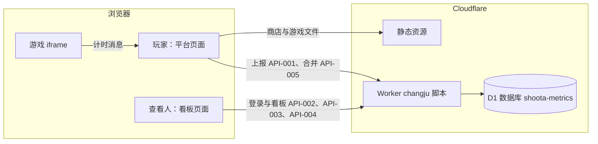
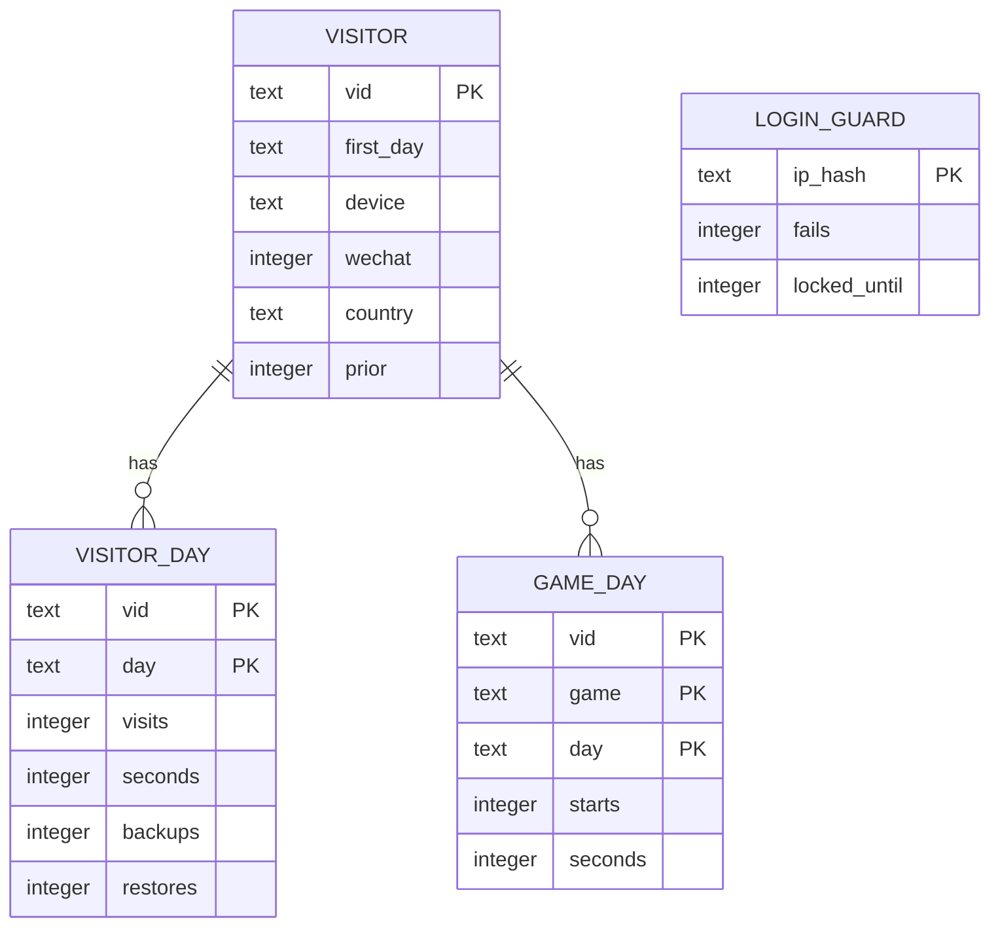
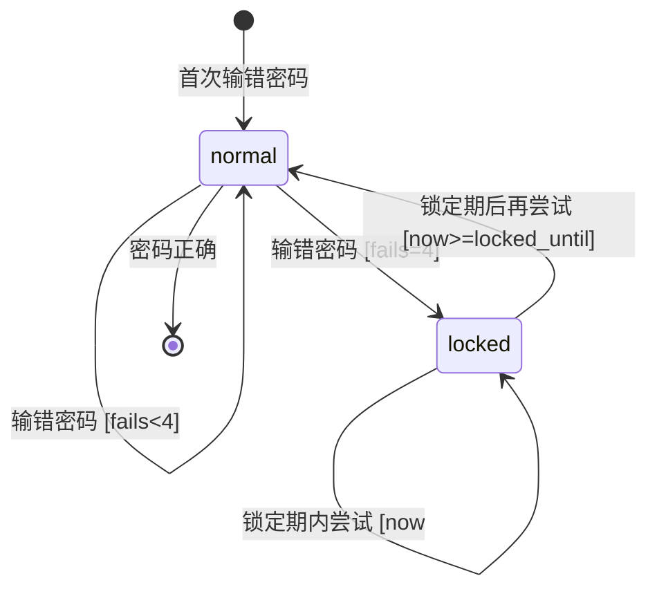
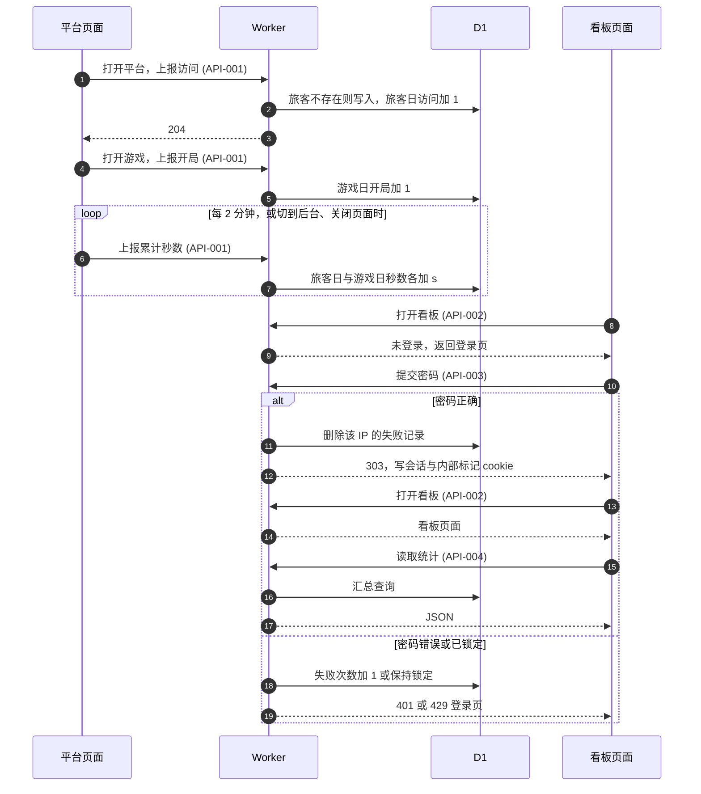
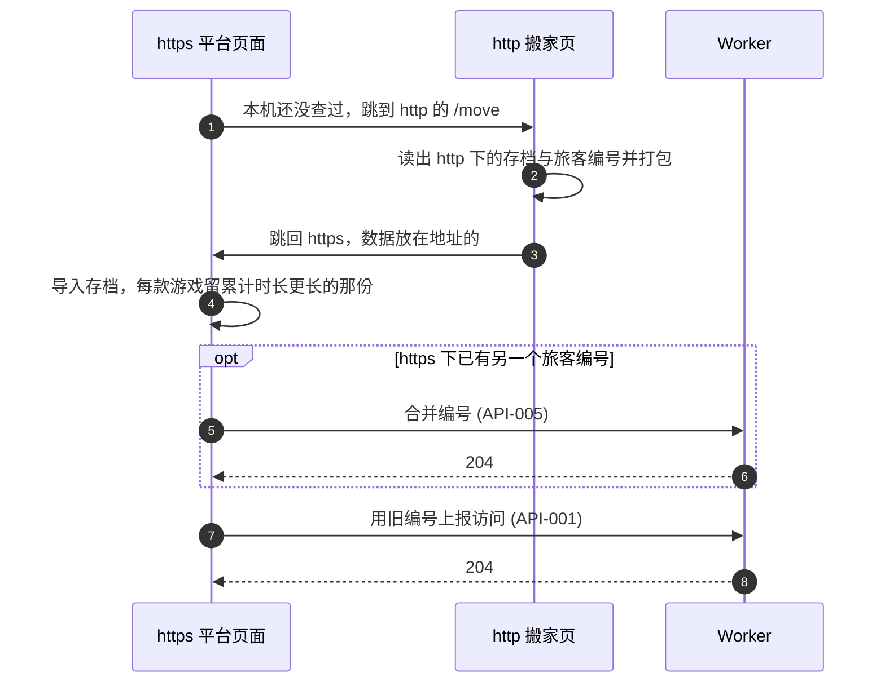
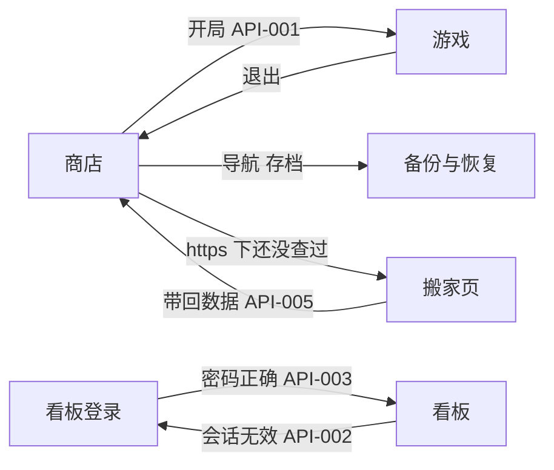
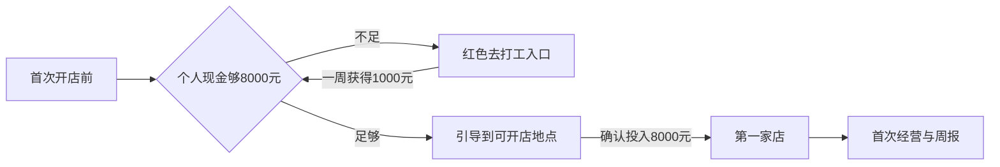
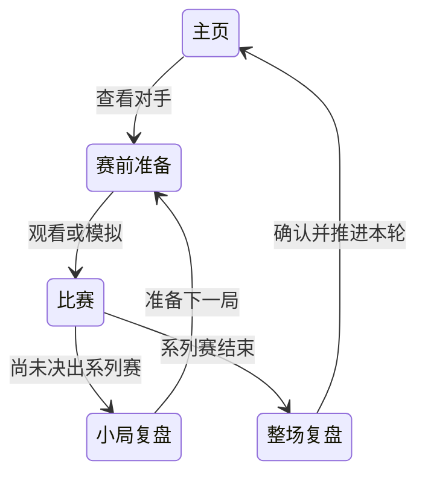

# shoota 游戏平台 设计文档

## 1. 元信息 / 变更记录

| 字段 | 值 |
| --- | --- |
| 状态 | 评审中 |
| 项目画像 | 生产产品 |
| Owner | Bearisbug |
| 评审人 | 老板、leizhang |
| 最后更新 | 2026-10-31 |
| 关联 | 仓库 https://github.com/Bearisbug/changju · 部署手册 `docs/DEPLOY.md` · 上线清单 `docs/LAUNCH.md` |

变更记录：

| 日期 | 版本 | 涉及 ID | 一句话 | 类型 |
| --- | --- | --- | --- | --- |
| 2026-10-31 | v0.63-platform | REQ-010、REQ-011、REQ-021、FLOW-GAME-CATALOG、FLOW-PLAY | 同步已验收游戏更新并首次上架全球高武文字版 | 功能、界面、拍板 |
| 2026-10-30 | v0.62-platform | REQ-010、REQ-011、REQ-021、FLOW-GAME-CATALOG、FLOW-PLAY | 同步两款LOL历史赛制、履历与休赛期经营成品 | 功能、界面 |
| 2026-10-30 | v0.61-platform | REQ-010、REQ-011、REQ-021、FLOW-GAME-CATALOG、FLOW-PLAY | 同步两款LOL能力上限与经理同源数值，保留目录和旧档 | 功能 |
| 2026-10-30 | v0.60-platform | REQ-010、REQ-011、REQ-021、FLOW-GAME-CATALOG、FLOW-PLAY | 同步两款LOL五场模拟及评分成长更新，保留此生新版和二十款目录 | 功能、界面 |
| 2026-10-30 | v0.59-platform | REQ-010、REQ-011、REQ-021、FLOW-GAME-CATALOG、FLOW-PLAY | 同步此生最新冻结成品与准确简介，核对旧档连续及原目录范围 | 功能、界面 |
| 2026-10-30 | v0.58-platform | REQ-007、REQ-010、REQ-011、REQ-021、FLOW-GAME-CATALOG、FLOW-PLAY、FLOW-KANBAN-VIEW | 同步两款LOL最终成品和正式名称，选手简介改16岁并验收旧档连续性 | 功能、界面、拍板 |
| 2026-10-29 | v0.57-platform | REQ-007、REQ-010、REQ-011、REQ-021、FLOW-GAME-CATALOG、FLOW-PLAY | 更新LOL经理成品与简介，在其后加入LOL选手生涯；两款冻结成品本地集成并修复二十款精选导航溢出 | 功能、界面、缺陷修复 |
| 2026-10-29 | v0.53 | REQ-010、REQ-021、FLOW-GAME-CATALOG、FLOW-PLAY | 同步航司飞机去向、满载客流推荐与闲置机接替成品 | 功能、界面 |
| 2026-10-29 | v0.52 | REQ-010、REQ-021、FLOW-GAME-CATALOG、FLOW-PLAY | 同步航司分级选择与公共机务横条移除成品 | 功能、界面 |
| 2026-10-28 | v0.51 | REQ-010、REQ-021、FLOW-GAME-CATALOG、FLOW-PLAY | 同步航司配机入口、航路竞争与千架存档优化成品 | 功能、缺陷修复 |
| 2026-10-28 | v0.50 | REQ-010、REQ-021、FLOW-GAME-CATALOG、FLOW-PLAY | 同步航司表单遮挡修复成品，保留596e历史证据 | 界面、缺陷修复 |
| 2026-10-28 | v0.49 | REQ-010、REQ-021、FLOW-GAME-CATALOG、FLOW-PLAY | 同步航司客流推荐、批量扩建与大机队性能成品 | 功能、缺陷修复 |
| 2026-10-28 | v0.48 | REQ-010、FLOW-GAME-CATALOG | 此生移至第二、航司第三、租车第十，其余保持相对顺序 | 界面、拍板 |
| 2026-10-28 | v0.47 | REQ-007、REQ-010、FLOW-KANBAN-VIEW、FLOW-GAME-CATALOG | 修复此生在看板中漏读游戏名称 | 缺陷修复 |
| 2026-10-28 | v0.46 | REQ-010、REQ-021、FLOW-GAME-CATALOG、FLOW-PLAY | 上架此生并同步航司冻结成品，保留存档修复 | 功能、界面 |
| 2026-10-28 | v0.45 | REQ-011、FLOW-PLAY、PAGE-PLAYER | 修复立即刷新丢进度和未写入却显示已存档 | 缺陷修复 |
| 2026-10-27 | v0.44 | REQ-010、FLOW-GAME-CATALOG | 上架一念长生，保留既有游戏顺序与存档 | 功能、界面 |
| 2026-10-27 | v0.43 | REQ-010、REQ-021 | 航司客流增长预览、一键开航增班与滚动检修 | 功能、界面 |
| 2026-10-26 | v0.42 | REQ-010、REQ-021 | 航司地球仪、经营助手、机型航速与大档保存更新 | 功能、界面、缺陷修复 |
| 2026-10-26 | v0.41 | REQ-010、REQ-021 | 航司发展提醒优先与经营提速 | 缺陷修复、界面 |
| 2026-10-26 | v0.40 | REQ-010、REQ-021 | 航司机场扩至1040座与165个国家和地区 | 功能 |
| 2026-10-26 | v0.39 | REQ-010、REQ-021 | 航司轻量结算、批量购机、机场成长及检修口碑修正 | 功能、界面、缺陷修复 |
| 2026-10-26 | v0.38 | REQ-010、REQ-021 | 航司周日历、航线舱位管理与三小时以上延误提醒 | 功能、界面 |
| 2026-10-25 | v0.37 | REQ-010、REQ-021 | 航司联动排班、机库持续扩建与经营提醒合并 | 功能、界面 |
| 2026-10-25 | v0.36 | REQ-010、REQ-021 | 航司时刻表、机场扩充与联程市场竞争更新 | 功能、界面 |
| 2026-10-25 | v0.35 | REQ-010、REQ-021 | 航司结算简化、同线增派与旧档保护 | 功能、界面 |
| 2026-10-25 | v0.34 | REQ-010、REQ-021 | 航司恢复规模封顶评分并按实际旅客体验积累口碑 | 功能、界面 |
| 2026-10-24 | v0.33 | REQ-010、REQ-021 | 同步航司借还款、地图、通知与经营评分更新 | 功能、界面 |
| 2026-10-24 | v0.32 | REQ-010、REQ-021 | 同步租车最终列表高度与桌面门店布局 | 界面 |
| 2026-10-24 | v0.31 | REQ-010、REQ-021 | 航司枢纽转机、班次便利度与扩张建议 | 功能、界面 |
| 2026-10-24 | v0.30 | REQ-010、REQ-021 | 同步租车批量管理、市场容量与网络协同更新 | 功能、界面 |
| 2026-10-24 | v0.29 | REQ-010、REQ-021 | 同步航司航线操作、自动保障与未来机型上市更新 | 功能、界面 |
| 2026-10-24 | v0.28 | REQ-010、REQ-021、FLOW-GAME-CATALOG | 同步五款游戏并上架航司与租车，调整前四位 | 功能、界面、拍板 |
| 2026-10-24 | v0.27 | REQ-010、REQ-021 | LOL生活剧情改为通知，比赛操作上移与竖屏分页 | 功能、界面、缺陷修复 |
| 2026-10-24 | v0.26 | REQ-010、REQ-021 | LOL翻卡对齐体育经理，默认LPL并修正Uzi与san强弱 | 缺陷修复、界面 |
| 2026-10-24 | v0.25 | REQ-013、REQ-021 | 恢复斗罗机缘分支并加入史莱克核心、伙伴选择与唐三决裂路线 | 功能、缺陷修复 |
| 2026-10-23 | v0.24 | REQ-010、REQ-021 | LOL按赛事、年龄与投入成长，增加可逆状态和生活剧情 | 功能、缺陷修复、界面 |
| 2026-10-23 | v0.23 | REQ-010、REQ-021 | LOL增加整场复盘、收支赞助及退役传奇开局 | 功能、界面、缺陷修复 |
| 2026-10-23 | v0.22 | REQ-010、REQ-021 | 同步娱乐圈人物演出与对白进度更新到双站 | 功能、界面 |
| 2026-10-23 | v0.21 | REQ-010、REQ-021 | 修正绿茵经理姓名列与球队队长默认资料 | 缺陷修复、界面 |
| 2026-10-23 | v0.20 | REQ-010 | 同步后宫、娱乐圈与首富本地更新到双站 | 功能、界面 |
| 2026-10-23 | v0.19 | REQ-010、FLOW-GAME-CATALOG | 调整商店及精选顺序，指定五款置前、三款置后 | 界面、拍板 |
| 2026-10-23 | v0.18 | REQ-010 | 首富修复手机遮挡，精简说明并引导打工攒8000元开店 | 界面、功能、缺陷修复 |
| 2026-10-22 | v0.17 | REQ-010、REQ-021 | F1车手改逐页推进，领队拆分直播与模拟入口 | 界面、缺陷修复 |
| 2026-10-22 | v0.16 | REQ-010 | 足球两款封面统一为柔光、低反光的写实体育摄影 | 界面、拍板 |
| 2026-10-22 | v0.15 | REQ-010 | 补齐历史批准的经营与剧情细项，核验15款入口和看板中文名 | 功能、缺陷修复 |
| 2026-10-22 | v0.14 | REQ-010、REQ-020、REQ-021、FLOW-PLAY | 接手14款游戏，加入两款足球并发布测试站；正式站不变 | 功能、缺陷修复、拍板 |
| 2026-10-22 | v0.13 | REQ-020、REQ-021、FLOW-PLAY、PAGE-STORE、PAGE-PLAYER、PAGE-BACKUP | 手机竖屏下平台页面改紧凑排版，游戏页顶栏压成一行；五款平台自管游戏按竖屏重排 | 界面 |
| 2026-10-22 | v0.11 | REQ-016、REQ-018、FLOW-PLAY、PAGE-PLAYER、ADR-005、ADR-006 | 撤回平台的横屏提示与整页旋转，真机上除薯光外都没法玩；手机竖着打开游戏恢复原样 | 缺陷修复、拍板 |
| 2026-10-22 | v0.10 | REQ-010 | F1-Driver 换版：开局可选比亚迪加入，默认 11 队，旧存档保持 12 队，游戏内改名 F1-Driver | 功能 |
| 2026-10-22 | v0.9 | REQ-017、FLOW-PLAY、PAGE-PLAYER | 打开游戏卡住时自动重试并提示，显示下载进度，游戏文件存在本机 | 缺陷修复、功能 |
| 2026-10-22 | v0.8 | REQ-016、FLOW-PLAY、PAGE-PLAYER、ADR-005 | 手机竖着打开横屏游戏时提示横过来，转不了可整页横向显示并左右划滚动；leizhang 选定平台层统一做 | 功能、界面、拍板 |
| 2026-10-21 | v0.7 | FLOW-SAVE-MOVE、FLOW-COLLECT、REQ-014、REQ-015、REQ-006、API-001、API-005、ENT-Visitor、PAGE-MOVE、INV-005、ADR-004 | http 下玩过的浏览器在 https 下自动搬回存档与旅客编号，统计前的老玩家不算新旅客，留存表注明统计首日 | 功能、缺陷修复 |
| 2026-10-21 | v0.6 | REQ-005、PAGE-KANBAN | 看板趋势图的峰值标注不再越出图表卡片 | 缺陷修复 |
| 2026-10-21 | v0.5 | REQ-010、REQ-011、REQ-012、REQ-013、FLOW-PLAY、PAGE-PLAYER、PAGE-STORE、PAGE-KANBAN-LOGIN、PAGE-KANBAN | 修正存档提示与外部链接，游戏字体不再阻塞显示，看板换品牌视觉，详情页去掉授权备注，术语表补人均游玩时长 | 缺陷修复、界面、文档 |
| 2026-10-21 | v0.4 | PAGE-STORE、PAGE-PLAYER、PAGE-BACKUP、FLOW-GAME-CATALOG、REQ-010 | 平台页面换成按 logo 新建的品牌视觉；新游戏链路已上线，状态改为已实现 | 界面、文档 |
| 2026-10-21 | v0.3 | REQ-010、FLOW-GAME-CATALOG | 上架三款独立生涯游戏，提供专属封面、准确简介和原平台存档接入 | 功能 |
| 2026-10-20 | v0.2 | FLOW-COLLECT、FLOW-KANBAN-LOGIN、FLOW-KANBAN-VIEW | 统计与看板上线，留存表改看近 60 天，设计仍待老板确认 | 功能 |
| 2026-10-20 | v0.1 | REQ-001、REQ-002、REQ-003、REQ-004、REQ-005、REQ-006、REQ-007、REQ-008、REQ-009、FLOW-COLLECT、FLOW-KANBAN-LOGIN、FLOW-KANBAN-VIEW | 新增匿名旅客统计和带密码的数据看板，初稿 | 功能 |

## L1. 链路总览

领域顺序：采集 → 游戏商店 → 看板

### 角色：玩家

| 链路 | 名称 | 领域 | 状态 | 涉及需求 |
| --- | --- | --- | --- | --- |
| FLOW-COLLECT | 匿名采集 | 采集 | 已实现 | REQ-001、REQ-002、REQ-003、REQ-009、REQ-015 |
| FLOW-GAME-CATALOG | 发现并游玩新游戏 | 游戏商店 | 已实现 | REQ-010 |
| FLOW-PLAY | 游玩与存档 | 游戏商店 | 已实现 | REQ-011、REQ-012、REQ-013、REQ-017、REQ-018、REQ-020、REQ-021 |
| FLOW-SAVE-MOVE | 存档搬到 https | 游戏商店 | 已实现 | REQ-014 |

### 角色：看板查看人

| 链路 | 名称 | 领域 | 状态 | 涉及需求 |
| --- | --- | --- | --- | --- |
| FLOW-KANBAN-LOGIN | 看板登录 | 看板 | 已实现 | REQ-004、REQ-009 |
| FLOW-KANBAN-VIEW | 查看指标 | 看板 | 已实现 | REQ-005、REQ-006、REQ-007、REQ-008 |

界面外壳：Web｜public/index.html、src/kanban.html

## L2. 链路卡

> 图例：现状待确认 = 实现已定、文档未写，等你确认是否定稿；无用例 = 这一行还没有测试用例；分支未与用户逐类核对 = 所列步骤的分支由 Agent 按文档与代码预填，还没和你逐类问过

### FLOW-SAVE-MOVE · 存档搬到 https

#### 概要

- **执行者**：玩家（ROLE-Visitor）
- **触发**：在 https 下打开平台的任意页面（PAGE-STORE）
- **进入条件**：这个浏览器在 https 下还没查过 http 下的旧数据
- **结果**：http 下的旧存档和旅客编号搬到 https，玩家接着玩，统计不多算一个旅客
- **不管**：换浏览器、换设备与无痕模式下的进度

#### 主流程

1. S1 平台页面发现还没查过，记下这是第几次去查，然后跳到 http 下的搬家页 〔无界面〕
2. S2 搬家页读出本机存档和旅客编号，打包后跳回 https 〔无界面〕
3. S3 平台页面导入存档，每款游戏留累计游玩时长更长的那份 〔无界面〕
4. S4 改用旧旅客编号，并请统计把 https 下的编号并进来（API-005） 〔无界面〕
5. S5 平台打开原来要去的页面，记一次访问（API-001） 〔界面：Web 商店｜public/index.html〕

#### 分支

##### S1 发现还没查过

| 类型 | 分支 | 结果 | 依据 | 测试 |
| --- | --- | --- | --- | --- |
| 边界 | 这个浏览器已经查过 | 不跳，直接打开平台 | 场景「全新浏览器只跳一次」 | TC-028 |
| 边界 | 浏览器写不了本地存储 | 不跳，直接打开平台 | 场景「全新浏览器只跳一次」 | 不测：各浏览器无痕模式表现不一 |

##### S2 搬家页打包

| 类型 | 分支 | 结果 | 依据 | 测试 |
| --- | --- | --- | --- | --- |
| 边界 | http 下没有存档也没有编号 | 带回「无数据」 | 场景「全新浏览器只跳一次」 | TC-028 |
| 边界 | 浏览器把搬家页升级成 https 打开 | 带回「无数据」 | 场景「搬家页在 https 下打开」 | TC-031 |
| 边界 | 打包后超过 190 万字符 | 只带回旅客编号，存档留在 http 那份 | ADR-004 | 不测：实测存档码最长 12.6 万字符 |
| 失败 | 搬家页打不开 | 这一次停在浏览器的错误页，下次打开 https 再试，最多 3 次 | §15 搬家页打不开；ADR-004 | 不测：http 不通时 https 也不通 |
| 失败 | 浏览器读本机存档 5 秒没回应 | 只带回编号，存档留在 http 那份 | §15 搬家页读存档没回应；ADR-004 | 不测：本地浏览器复现不了 |

##### S3 导入存档

| 类型 | 分支 | 结果 | 依据 | 测试 |
| --- | --- | --- | --- | --- |
| 边界 | 两边都有同一款游戏 | 留累计游玩时长更长的那份，另一份被替换 | 场景「两边都有同一款游戏的进度」 | TC-029 |
| 失败 | 带回的数据读不出来 | 不导入，平台照常打开 | §15 搬家数据读不出来；ADR-004 | 无用例 |
| 边界 | 本机没有发起搬家时地址带着搬家数据（如别人转发的链接） | 不导入，只去掉地址里的数据，下次打开照常去查 | ADR-004 | TC-031 |

##### S4 改用旧编号

| 类型 | 分支 | 结果 | 依据 | 测试 |
| --- | --- | --- | --- | --- |
| 边界 | https 下还没有编号 | 直接用旧编号，不请求合并 | API-005 | TC-027 |
| 边界 | http 下有存档但没有编号 | 新领的编号标为老玩家 | 场景「统计前就玩过的浏览器」；字段 visitors.prior | 无用例 |
| 失败 | 合并请求格式不对 | 400 `/errors/bad-merge` | `/errors/bad-merge`；API-005 | TC-029 |
| 失败 | 合并请求没送到 | 两个编号都留在统计里，之后只用旧编号 | §16 网络失败的批次直接丢弃；API-005 | 无用例 |
| 并发 | 两个标签页同时搬家 | 只并一次，第二次什么都不做 | 竞态「两个标签页同时搬家」；INV-005 | 无用例 |

##### S5 打开平台

| 类型 | 分支 | 结果 | 依据 | 测试 |
| --- | --- | --- | --- | --- |
| 失败 | 访问上报格式不对 | 400 `/errors/bad-event`，这次访问没记上 | `/errors/bad-event`；API-001 | 不测：本链路只发平台自己拼的上报 |

#### 待决策

无。

另见：API-005；字段 visitors.prior；§23 强制 https 换成放行搬家页的跳转规则；§28 搬家跳转保留到 2026-11-21

#### 关联

- **契约锚点**：API-005；API-001；ADR-004；PAGE-MOVE
- **上游**：—
- **下游**：FLOW-PLAY
- **守住的不变量**：INV-003、INV-005

| 步骤 | 位置 |
| --- | --- |
| S1 | `public/index.html#moveCheck` |
| S2 | `public/move.html#pack` |
| S3、S5 | `public/index.html#moveIn` |
| S4 | `public/index.html#moveIn`；`src/worker.js#merge` |

## L3. 业务规则

无。

## L4. 不变量

| ID | 不变量 | 由什么保证 | 验证 |
| --- | --- | --- | --- |
| INV-001 | 一次时长上报最多计入 300 秒 | API-001；字段 visitor_days.seconds | TC-004 |
| INV-002 | 带内部标记的浏览器发来的上报不写入任何统计表 | API-001；ADR-003 | TC-006 |
| INV-003 | 每个旅客编号在旅客表里只有一行 | 字段 visitors.vid；竞态「同一旅客两个标签页同时首访」 | TC-001、TC-007 |
| INV-004 | 未登录的请求拿不到任何统计数字 | API-004；API-002 | TC-010 |
| INV-005 | 被合并掉的旅客编号在三张统计表里都没有行 | API-005；竞态「两个标签页同时搬家」 | TC-029 |

## 2. 背景 / 目标 / 非目标

- 背景：平台没有账号，进度存在玩家浏览器里，运营方现在看不到有多少人在玩、玩多久、会不会回来。
- 本文档主要覆盖统计与看板，三款新游戏的上架规则补充于 §30。
- 游玩时的存档提示与外部链接补充于 REQ-011、REQ-012，游戏字体加载的要求见 §15 首屏要求。
- 其他已有商店功能仍按上线冒烟集验收。
- 手机竖着打开游戏时平台不转横，见 §41 手机竖着打开游戏。
- 手机竖屏的紧凑排版见 §45 平台竖屏紧凑排版，各游戏的竖屏适配见 §46 自管游戏竖屏适配。
- 2026-10-21 起站点强制 https，之前在 http 下玩过的浏览器经搬家页找回存档，见 `FLOW-SAVE-MOVE`。
- 目标：按浏览器匿名统计访问、开局和游玩时长，在 shoota.ai/kanban 用密码查看活跃、留存、时长和各游戏排行。
- 非目标：游戏内部事件统计，现有游戏没有上报接口，需要游戏作者配合，放到下一期。
- 非目标：实时在线人数、导出 CSV、多账号或多密码、告警推送。
- 非目标：站内隐私提示，产品决定不加，风险记在 §28。
- 非目标：识别同一个人的多台设备，没有账号做不到。

规模画像：

| 维度 | 估算 | 依据 / 假设 |
| --- | --- | --- |
| 用户量 | 日活旅客 ≤ 500，同时在玩 ≤ 50 | 假设：站点刚公开、靠微信转发；日活超过 500 需重估 |
| 请求量 | 采集上报峰值约 1 次/秒，看板读取每天 < 100 次 | 每人每 2 分钟 1 次上报，50 人同时在玩 |
| 数据量 | 每天新增约 1,500 行，12 个月约 55 万行、约 60 MB | 每个活跃旅客每天约 1 行旅客日加 2 行游戏日 |
| 分布与形态 | 单区，玩家主要在中国大陆 | Cloudflare 全球节点，国内访问速度未测 |

## 3. 成功指标 / 验收阈值

| 指标 | 定义 | 当前 | 目标 | 由哪些事件算 |
| --- | --- | --- | --- | --- |
| 日活旅客 | 北京日期当天有任意上报的旅客数 | 无数据 | 上线后 7 天内建立基线 | 见 `EVT:visit`、`EVT:play_time` |
| 次日留存 | 首访次日又有上报的旅客占当天新旅客的比例 | 无数据 | 上线后 14 天内建立基线 | 见 `EVT:visit` |
| 人均游玩时长 | 当天游玩秒数总和除以当天活跃旅客数 | 无数据 | 上线后 7 天内建立基线 | 见 `EVT:play_time` |
| 时长上报完整率 | 服务端收到的秒数占玩家本地计时秒数的比例 | 无数据 | ≥ 95%，本地测试测得 | 见 `EVT:play_time` |

## 4. 术语表 / 统一语言

| 术语 | 定义 | 代码/字段标识 | 对应实体 |
| --- | --- | --- | --- |
| 旅客 | 一个浏览器，换设备、换浏览器或清缓存都算新旅客 | `vid` | `ENT-Visitor` |
| 旅客编号 | 浏览器第一次打开平台时生成的 32 位随机十六进制串 | `vid` | `ENT-Visitor` |
| 北京日期 | 按东八区计算的日期，所有按天统计都用它 | `day` | `ENT-VisitorDay` |
| 活跃旅客 | 某个北京日期内有任意上报的旅客 | — | `ENT-VisitorDay` |
| 新旅客 | 首访日期等于当天、且不是老玩家的旅客 | `first_day` | `ENT-Visitor` |
| 老玩家 | 领旅客编号时本机已有平台数据的旅客，即统计上线前就玩过的人 | `prior` | `ENT-Visitor` |
| 统计首日 | 2026-10-20，统计从这天 02:41 起上线 | `STATS_START` | `ENT-Visitor` |
| 老玩家识别上线日 | 平台开始给老玩家打标记的那天；统计首日到这天首访的新旅客含没被认出的老玩家 | `PRIOR_SINCE` | `ENT-Visitor` |
| 搬家页 | http 下的 `/move`，把这个浏览器 http 下的存档和旅客编号带到 https | — | — |
| 开局 | 玩家在平台上打开一款游戏一次 | `starts` | `ENT-GameDay` |
| 游玩时长 | 游戏页面在前台的秒数，平台每 5 秒计一次 | `seconds` | `ENT-VisitorDay` |
| 人均游玩时长 | 游玩时长总和除以活跃旅客数；活跃旅客为 0 时看板显示「—」 | — | `ENT-VisitorDay` |
| N 日留存 | 首访日期之后第 N 天又有上报的新旅客占比，N 取 1、7、30 | — | `ENT-VisitorDay` |
| 留存表范围 | 近 60 天的首访日期，30 日留存要首访满 30 天才有值 | — | `ENT-Visitor` |
| 内部浏览器 | 登录过看板的浏览器，它的上报一律不计入 | `sk_staff` | — |
| 看板 | shoota.ai/kanban，凭密码查看统计 | — | — |

## 5. 功能清单与需求 ID

| ID | 功能 | 对应目标 | 优先级 |
| --- | --- | --- | --- |
| REQ-001 | 首次打开平台时生成旅客编号，每次打开记一次访问 | 匿名统计 | P0 |
| REQ-002 | 打开游戏记一次开局，游戏在前台时累计并上报游玩时长 | 匿名统计 | P0 |
| REQ-003 | 复制存档码与恢复进度成功时各记一次 | 匿名统计 | P1 |
| REQ-004 | 看板凭一个密码登录，同一 IP 连错 5 次锁 15 分钟 | 密码看板 | P0 |
| REQ-005 | 看板显示概览与近 30 天每日趋势 | 密码看板 | P0 |
| REQ-006 | 看板显示近 60 天新旅客的次日、7 日、30 日留存表 | 密码看板 | P0 |
| REQ-007 | 看板显示各游戏的玩家数、开局数、时长与次日回访率 | 密码看板 | P0 |
| REQ-008 | 看板显示微信内打开占比、手机与电脑占比、地区前 10 | 密码看板 | P1 |
| REQ-009 | 登录过看板的浏览器之后的上报不计入统计 | 数据干净 | P0 |
| REQ-010 | 玩家在商店、搜索和游戏库找到已上架游戏，看专属封面与简介，开局并恢复各自进度 | 新游戏上架 | P0 |
| REQ-011 | 游戏页顶栏只在存档内容变化后显示「已存档」与时间 | 游玩体验 | P1 |
| REQ-012 | 游戏里的外部链接在浏览器新标签页打开 | 游玩体验 | P1 |
| REQ-013 | 斗罗·万相换成优化版后，玩家用旧存档接着玩 | 游玩体验 | P0 |
| REQ-014 | 在 https 下打开平台时，搬回同一浏览器 http 下的存档和旅客编号 | 游玩体验 | P0 |
| REQ-015 | 老玩家不算新旅客，留存表注明统计首日 | 数据干净 | P1 |
| REQ-016 | 已废弃，被 REQ-018 取代：手机竖着打开横屏游戏时提示转横 | 游玩体验 | P1 |
| REQ-017 | 打开游戏显示下载进度，卡住时重试或提示，同版本再开不重新下载 | 游玩体验 | P0 |
| REQ-018 | 手机竖着打开游戏时平台不提示转横、不旋转，横屏由游戏自己处理 | 游玩体验 | P0 |
| REQ-020 | 手机竖屏下平台页面紧凑显示，游戏页顶栏只占一行 | 游玩体验 | P1 |
| REQ-021 | 五款平台自管的游戏在手机竖屏能顺畅玩 | 游玩体验 | P1 |

REQ-001、REQ-002、REQ-003、REQ-009 都经同一个上报接口落库，见 §8 `API-001`。

## 6. 总体架构



- 只有 `/api/*` 与 `/kanban` 开头的请求先进 Worker 脚本，其余请求直接由静态资源返回，不计入 Worker 调用次数。
- 看板页面 `src/kanban.html` 打包进 Worker 脚本，不放在 `public/` 下，未登录拿不到。
- 游戏在沙箱 iframe 里运行，读写不到平台的存储，只能经平台消息存档。
- 沙箱允许游戏开新标签页，游戏里的外部链接在新标签页打开，见 `REQ-012`。
- http 请求只放行搬家页 `/move`，其余由 Cloudflare 跳转规则 301 到 https，见 `FLOW-SAVE-MOVE`、`ADR-004`。

## 7. 数据模型 / 领域实体



- `ENT-Visitor`：表 `visitors`，一个旅客一行，首次上报时写入，之后不改。
- `ENT-Visitor` 被合并掉时整行删除，见 `API-005`。
- 已签字：`visitors.prior` 列，用户 2026-10-21 签字，同日上线。
- `ENT-VisitorDay`：表 `visitor_days`，一个旅客一个北京日期一行，累加访问、时长、备份与恢复次数。
- `ENT-GameDay`：表 `game_days`，一个旅客一款游戏一个北京日期一行，累加开局与时长。
- `ENT-LoginGuard`：表 `login_guards`，一个 IP 摘要一行，记看板登录失败次数与锁定到期时间。

## 8. 接口契约

契约文件：无，接口只有 5 个，以本节为准。

- **`API-001` collect** — 实现 `REQ-001`、`REQ-002`、`REQ-003`、`REQ-009`
  - 方法/路径：`POST /api/e`
  - 鉴权/权限：匿名，见 §10 `ROLE-Visitor`
  - 请求：JSON，`v` 为旅客编号，`ev` 为事件数组，每项含类型 `t`，可带游戏 `g` 与秒数 `s`
  - 老玩家：请求可带 `o` 为 1，旅客首次写入时记为老玩家，之后的值不改记录
  - 请求限制：一次最多 20 个事件，正文不超过 8 KB
  - 响应：204 无正文；带内部标记 `sk_staff` 时同样 204，但不写库
  - 错误：400 `/errors/bad-event`
  - 幂等：不幂等，同一批重发会重复累加，前端不自动重试
  - 缓存与超时：不缓存，前端用 `fetch` 的 keepalive 或 `sendBeacon` 发送，失败丢弃
- **`API-002` kanbanPage** — 实现 `REQ-004`、`REQ-005`、`REQ-006`、`REQ-007`、`REQ-008`
  - 方法/路径：`GET /kanban`
  - 鉴权/权限：会话 cookie `sk_session` 有效时返回看板页面，否则返回登录页
  - 响应：200 HTML，两种页面都带 `Cache-Control: no-store`
  - 错误：无，未登录返回登录页而不是错误
- **`API-003` kanbanLogin** — 实现 `REQ-004`、`REQ-009`
  - 方法/路径：`POST /kanban/login`
  - 请求：表单字段 `password`
  - 响应：密码正确时 303 跳回 `/kanban`，同时写会话 cookie 与内部标记 cookie
  - 错误：401 `/errors/wrong-password`、429 `/errors/login-locked`
  - 错误时返回登录页 HTML，页内显示提示与剩余次数或解锁时间
- **`API-004` kanbanData** — 实现 `REQ-005`、`REQ-006`、`REQ-007`、`REQ-008`
  - 方法/路径：`GET /kanban/data`
  - 鉴权/权限：见 §10 `ROLE-Staff`
  - 响应：200 JSON，含概览、每日趋势、留存、游戏排行、来源与设备五块
  - 错误：401 `/errors/not-logged-in`
  - 缓存与超时：不缓存，前端超时 15 秒，失败时显示重试按钮
- **`API-005` mergeVisitor** — 实现 `REQ-014`
  - 方法/路径：`POST /api/merge`
  - 鉴权/权限：匿名，见 §10 `ROLE-Visitor`
  - 请求：JSON，`v` 为要保留的旧旅客编号，`from` 为要并进来的编号
  - 动作：`from` 的旅客日与游戏日逐行累加进 `v`，然后删掉 `from` 在三张表的行
  - 动作：`v` 在旅客表没有行时，先照抄 `from` 那一行
  - 响应：204 无正文；带内部标记 `sk_staff` 时同样 204，但不写库
  - 错误：400 `/errors/bad-merge`
  - 幂等：幂等，重发时 `from` 已经没有行，什么都不改
  - 已签字：用户 2026-10-21 签字，同日上线

演进与弃用：

- 版本方案：不分版本，平台页面与 Worker 同一次部署发布
- 弃用期：N/A — 调用方只有本仓自己的页面，同次发布同时更新
- 当前 deprecated 清单：无

## 9. 数据字典

| 字段 | API 名 | DB 名 | 类型 | 必填 | 枚举/约束 | 单位/精度 | PII |
| --- | --- | --- | --- | --- | --- | --- | --- |
| 旅客编号 | `v` | `visitors.vid` | text | 是 | 32 位小写十六进制 | — | 化名 |
| 事件类型 | `t` | — | text | 是 | visit、start、play、backup、restore，其他值整批拒绝 | — | 否 |
| 游戏 | `g` | `game_days.game` | text | start 与 play 必填 | 小写字母、数字、连字符，1 到 32 位 | — | 否 |
| 上报秒数 | `s` | — | integer | play 必填 | 1 到 300 | 秒 | 否 |
| 首访日期 | — | `visitors.first_day` | text | 是 | YYYY-MM-DD，北京日期 | 日 | 否 |
| 设备类型 | — | `visitors.device` | text | 是 | mobile、desktop，按首访请求的 UA 判断 | — | 否 |
| 微信内打开 | — | `visitors.wechat` | integer | 是 | 0、1，UA 含 MicroMessenger 为 1 | — | 否 |
| 国家或地区 | — | `visitors.country` | text | 是 | ISO 3166 两位代码，取不到写 XX | — | 否 |
| 老玩家 | `o` | `visitors.prior` | integer | 是 | 0、1，首次写入时请求带 `o` 为 1 则为 1，默认 0 | — | 否 |
| 合并来源 | `from` | — | text | 是 | 32 位小写十六进制，不能等于 `v` | — | 化名 |
| 日期 | — | `visitor_days.day` | text | 是 | YYYY-MM-DD，北京日期 | 日 | 否 |
| 访问次数 | — | `visitor_days.visits` | integer | 是 | ≥ 0 | 次 | 否 |
| 旅客日游玩秒数 | — | `visitor_days.seconds` | integer | 是 | ≥ 0，单次累加不超过 300 | 秒 | 否 |
| 备份次数 | — | `visitor_days.backups` | integer | 是 | ≥ 0 | 次 | 否 |
| 恢复次数 | — | `visitor_days.restores` | integer | 是 | ≥ 0 | 次 | 否 |
| 游戏日日期 | — | `game_days.day` | text | 是 | YYYY-MM-DD，北京日期 | 日 | 否 |
| 开局次数 | — | `game_days.starts` | integer | 是 | ≥ 0 | 次 | 否 |
| 游戏日游玩秒数 | — | `game_days.seconds` | integer | 是 | ≥ 0 | 秒 | 否 |
| IP 摘要 | — | `login_guards.ip_hash` | text | 是 | 加盐 SHA-256 的前 32 位，不存原始 IP | — | 化名 |
| 失败次数 | — | `login_guards.fails` | integer | 是 | 0 到 5 | 次 | 否 |
| 锁定到期 | — | `login_guards.locked_until` | integer | 否 | Unix 毫秒，未锁定为空 | 毫秒 | 否 |
| 会话 cookie | `sk_session` | — | text | — | 到期时间加 HMAC 签名，有效 7 天，HttpOnly | — | 否 |
| 内部标记 cookie | `sk_staff` | — | text | — | 值为 1，有效 1 年，HttpOnly | — | 否 |

## 10. 权限与角色

| 角色 \ 操作 | API-001 上报 | API-002 看板页面 | API-003 登录 | API-004 看板数据 | API-005 合并 |
| --- | --- | --- | --- | --- | --- |
| ROLE-Visitor | ✓ | 只看到登录页 | ✓ | ✗ | ✓ |
| ROLE-Staff | ✓，但不写库 | ✓ | ✓ | ✓ | ✓，但不写库 |

- `ROLE-Visitor`：任何打开平台的人，匿名。
- `ROLE-Staff`：浏览器持有有效会话 cookie 的看板查看人，只有一个共享密码。
- 所有人可见的页面：`PAGE-STORE`、`PAGE-PLAYER`、`PAGE-BACKUP`、`PAGE-MOVE`、`PAGE-KANBAN-LOGIN`。
- 仅 `ROLE-Staff` 可见的页面：`PAGE-KANBAN`。

## 11. 状态机

看板登录防护（`ENT-LoginGuard`）有正常与锁定两个状态，锁定由失败次数与锁定到期时间决定。



迁移表：

| 源 → 目标 | 事件 | 守卫(纯布尔) | 动作(副作用) | 谁触发 | 接口/事件 |
| --- | --- | --- | --- | --- | --- |
| [*] → normal | 首次输错密码 | — | 建记录，失败次数为 1，返回 401 | 查看人 | `API-003` |
| normal → normal | 输错密码 | fails < 4 | 失败次数加 1，返回 401 | 查看人 | `API-003` |
| normal → locked | 输错密码 | fails = 4 | 失败次数为 5，锁定到期为 15 分钟后，返回 429 | 查看人 | `API-003` |
| locked → locked | 锁定期内尝试 | now < locked_until | 不比对密码，返回 429 | 查看人 | `API-003` |
| locked → normal | 锁定期后再尝试 | now >= locked_until | 失败次数清零，再按本次密码对错处理 | 查看人 | `API-003` |
| normal → [*] | 密码正确 | — | 删除记录，写会话与内部标记 cookie | 查看人 | `API-003` |

旅客、旅客日、游戏日三张表没有状态字段，只做累加，不建状态机。浏览器本地的「查 http 旧数据」标记：跳去搬家页前记下这是第几次（1 到 3），带回后改成「查完了」；「查完了」或试满 3 次后不再跳，不建状态机。

游戏页的显示方向不建状态机：平台只按窗口大小显示游戏，不提示转横也不旋转，见 `REQ-018`。

## 12. 关键流程时序



存档搬家（`FLOW-SAVE-MOVE`）：



## 13. 页面与跳转地图



| 页面 | 路径 | 可见角色 | 调用接口 | 关键页态 |
| --- | --- | --- | --- | --- |
| `PAGE-STORE` | `/#store` | 所有人 | `API-001` | 已有页面，本期只加访问上报 |
| `PAGE-PLAYER` | `/#play-<游戏>` | 所有人 | `API-001` | 存档提示见 `REQ-011`，载入失败见 `REQ-017`，手机竖着不转横见 `REQ-018` |
| `PAGE-BACKUP` | `/#backup` | 所有人 | `API-001` | 已有页面，本期加备份与恢复上报 |
| `PAGE-MOVE` | `http://shoota.ai/move` | 所有人 | 无 | 没有可见内容，读完数据立刻跳回 https |
| `PAGE-KANBAN-LOGIN` | `/kanban` | 所有人 | `API-003` | 密码错误、已锁定两种提示 |
| `PAGE-KANBAN` | `/kanban` | `ROLE-Staff` | `API-004` | 加载中、无数据、读取失败三种页态 |

视觉来源：品牌目录 `brand/`，规范见 `brand/DESIGN.md`；参考是用户 2026-10-21 提供的 shoota logo 图。平台页面与看板页面都已接入。

## 14. 错误处理与错误码

| 错误码(type) | HTTP | 语义 | FE 处理 |
| --- | --- | --- | --- |
| `/errors/bad-event` | 400 | 上报格式不对，整批丢弃 | 平台页面不提示、不重试 |
| `/errors/bad-merge` | 400 | 合并请求的编号格式不对或两个编号相同 | 平台页面不提示、不重试 |
| `/errors/wrong-password` | 401 | 看板密码错误 | 登录页显示「密码不对，还能试 N 次」 |
| `/errors/login-locked` | 429 | 同一 IP 连错 5 次，锁定中 | 登录页显示几点几分后再试 |
| `/errors/not-logged-in` | 401 | 看板会话不存在或已过期 | 看板页面跳回登录页 |

- 错误信封：JSON 接口返回 `application/problem+json`，含 `type`、`title`、`instance`。
- 登录页的错误直接渲染进 HTML，不返回 JSON。
- 排障关联：用 Cloudflare 自带的 `cf-ray` 请求头作关联 ID，写进错误信封的 `instance` 与 Worker 日志。

## 15. 非功能需求

| 维度 | 场景 | 目标 |
| --- | --- | --- |
| 延迟 | `API-001` 上报，Worker 内处理 | P99 < 300 ms，不阻塞游戏 |
| 延迟 | `API-004` 读取 30 天统计 | P99 < 2 s，数据量按 §2 规模画像 |
| 容量 | Worker 调用次数 | 每天 < 10 万次，即免费额度，约 3,300 小时游玩 |
| 容量 | D1 写入行数 | 每天 < 10 万行，即免费额度，约 1,600 小时游玩 |
| 限流 | `API-003` 按 IP | 连错 5 次锁 15 分钟，返回 429，见 §14 错误码表 |
| 限流 | `API-001` 单次请求 | 最多 20 个事件、8 KB，超出返回 400 |
| 数据增长 | 三张统计表 12 个月 | 约 55 万行、60 MB，免费额度 5 GB，无需清理 |
| 数据增长 | 重估阈值 | 数据库超过 1 GB 或日活超过 500 时重估 |
| 兼容性 | 浏览器 | 支持 `fetch` keepalive 或 `sendBeacon` 的浏览器，含微信内置浏览器 |
| 兼容性 | 搬家数据放在地址里 | 不超过 190 万字符，Edge 与 WebKit 实测可用 |
| 容错 | 下载游戏文件 15 秒没有新数据 | 自动重下一次，再卡住提示网络不稳定，给重试与返回 |
| 容错 | 本机存档库 3 秒没回应 | 重连一次，还不行提示刷新页面，不进游戏，免得显示空存档 |
| 首屏 | 再次打开同一版本的游戏 | 从本机读取，不重新下载，版本按目录登记的文件大小判断 |
| 容错 | 搬家数据读不出来 | 不导入，平台照常打开 |
| 容错 | 搬家页打不开 | 每个浏览器最多试 3 次，之后直接打开平台 |
| 容错 | 搬家页读存档没回应 | 5 秒后不带存档跳回 |
| 首屏 | 游戏引用的 Google Fonts 连不上 | 游戏正文不等字体，iframe 载入后 1 秒内显示 |
| 首屏 | 游戏文件入库 | 外部字体样式表一律异步加载，`scripts/check.mjs` 拦下阻塞写法 |

## 16. 并发与一致性

| 竞态场景 | 参与方 | 期望结果 | 依据(约束/守卫) |
| --- | --- | --- | --- |
| 同一旅客两个标签页同时首访 | `API-001` × 2 | 旅客表只有一行，访问次数各加 1 | `visitors.vid` 主键，插入用 INSERT OR IGNORE |
| 同一旅客两个标签页同时上报时长 | `API-001` × 2 | 两份秒数都累加，两个标签页都在玩就都算 | 累加用 ON CONFLICT DO UPDATE |
| 同一 IP 同时提交多次错误密码 | `API-003` × N | 失败次数逐次累加，第 5 次起锁定 | 单条 UPSERT 更新 `login_guards.fails` |
| 两个标签页同时搬家 | `API-005` × 2 | 只并一次，第二次时 `from` 已没有行，什么都不改 | 合并在一个 D1 批处理里完成 |
| 合并时 `from` 还有上报在路上 | `API-005`、`API-001` | 晚到的上报给 `from` 重新建一行，只有这一次的数字 | 接受，搬家后页面只用旧编号 |
| 搬家时还开着上线前加载的页面 | 本机 `changju.meta.v1` | 旧页面下次保存时把导入前的数据写回 | 接受，只影响上线那一刻开着页面的人 |

一致性承诺：

- read-after-write：上报写入后，看板下一次读取即可见，没有缓存。
- 异步投递：上报最多一次，网络失败的批次直接丢弃，不重试，不会重复累加。

### 游戏存档的提交与恢复（REQ-011）

- 平台接收游戏变更后，先同步写本机恢复记录，再排队写入存档库。
- 恢复记录和原存档都按玩家、游戏分别保存，不发送到服务器。
- 原游戏字典、存档码和桥接消息格式保持兼容。
- 同一玩家同一游戏逐次完成写入，连续变化合并为最新完整快照。
- 切换游戏或退出再进入时读取最新快照，旧提交不能改另一款游戏的提示。
- 只有存档库事务完成才显示「已存档」与时间，内存或临时恢复记录不能冒充完成。
- 原样写回或同一批次写入后删除、最终内容不变时，保留原读取提示。
- 写入失败时保留最新内容，提示「暂存待重试」或「保存失败·重试」并允许重试。
- 临时记录也写不了时，明确提示离开会丢失未保存进度。
- 重新进入时优先恢复未完成的最新记录，读取失败不得当作新档覆盖。
- 重试按钮保持键盘可达，触摸命中区至少44像素，不挤占游戏画面。
- 备份导出包含最新待提交进度，恢复与旧域搬家也进入同一保存队列。
- 恢复事务失败不报恢复成功，提交后只清理属于该快照的临时记录。
- 保护范围从平台收到游戏消息开始，未送达平台的变化无法恢复。
- 系统强杀、存储被清除或两种存储均不可用时，不能保证恢复最后一步。
- 多标签页同时玩同一存档不合并分支，本次不新增跨标签协同。
- 验证覆盖立即刷新、失败重试、连续写入、隔离、备份和触摸可达，见 TC-SAVE-001 至 TC-SAVE-005。

## 17. 依赖与外部系统 / SLA

| 依赖 | 用途 | SLA | 超时/重试 | 失败影响 | 降级 |
| --- | --- | --- | --- | --- | --- |
| Cloudflare Workers | 跑上报与看板脚本 | 免费版无 SLA | 单次请求 CPU 10 ms 上限 | 上报丢失，看板打不开 | 游戏照常可玩，统计缺这段数据 |
| Cloudflare D1 | 存统计数据 | 免费版无 SLA | 单条查询失败不重试 | 这一批上报丢失 | 同上 |

内部后台任务：无，统计在查询时现算，没有定时任务。

## 18. ADR 决策记录

- **`ADR-001` 只存按天汇总的表，不存原始事件** — Status: Proposed
  - Context：免费额度每天 10 万行写入，看板只需要按天的数字。
  - Decision：上报直接累加到旅客日与游戏日表，不留逐条事件。
  - Alternatives：存原始事件，写入行数多几十倍，还要定期清理
  - Alternatives：Workers Analytics Engine，要另配查询 token，数据只留 3 个月
  - Consequences：以后想按小时或按单次游戏分析，只能从改版那天起积累。
- **`ADR-002` 旅客按浏览器本地随机编号识别** — Status: Proposed
  - Context：平台没有账号，产品要求不加账号。
  - Decision：首次打开时生成随机编号存在浏览器本地，随每次上报发送。
  - Alternatives：按 IP 加 UA 识别，同一 Wi-Fi 下的人会被并成一个，也更像个人信息。
  - Consequences：清缓存、换浏览器会被算成新旅客，留存会偏低。
- **`ADR-003` 登录过看板的浏览器靠 cookie 排除** — Status: Proposed
  - Context：老板和协作者自己玩会抬高数字。
  - Decision：登录成功时写一个有效 1 年的内部标记 cookie，带它的上报不写库。
  - Alternatives：按 IP 排除，家里和公司换网络就失效。
  - Consequences：登录看板之前的历史数据仍算在内，没登录过看板的内部人员也会被算进去。
- **`ADR-004` http 旧存档经地址 # 之后的部分带到 https** — Status: Proposed
  - Context：http 与 https 在浏览器里是两份存储，强制 https 后 http 下玩过的人看不到存档。
  - Context：Chrome 从 115 起会把 http 导航先改成 https，Edge 155 实测相同，这类浏览器的存档本来就在 https 下。
  - Context：存档留在 http 下的是不自动升级 https 的浏览器。
  - Decision：https 页面跳到 http 搬家页，搬家页把数据压缩后放在跳回地址的 # 之后，不经服务器。
  - Alternatives：搬家页把数据表单提交给 Worker 再写回页面，没有长度上限，但存档要经过服务器。
  - Alternatives：让玩家自己去 http 页面复制存档码，大多数人不会发现存档还在。
  - Alternatives：https 下的 `/move` 再跳回 http，但 Chrome 154、155 起默认在这种回退前弹「连接不安全」警告。
  - Consequences：每个浏览器第一次在 https 下打开时多跳一次。
  - Consequences：自动升级的浏览器跳到的是 https 下的搬家页，带回「无数据」，不弹警告。
  - Consequences：数据超过 190 万字符时只搬编号，存档留在 http 那份。
  - Consequences：地址里的数据谁都能伪造，平台只在本机发起了搬家时导入。

- **`ADR-005` 横屏提示做在平台游戏页，不改游戏文件** — Status: Superseded(被 `ADR-006` 取代)
  - Context：游戏装在平台游戏页的 iframe 里，上面还有平台顶栏。
  - Context：游戏文件经常整份换版，见 §34 到 §40。
  - Decision：由平台游戏页判断与提示，转不了时把顶栏和游戏一起转 90 度。
  - Alternatives：照薯光的做法在每个游戏里各加一份，平台顶栏仍竖着，换版就丢。
  - Consequences：新上架的游戏默认要横屏，竖屏游戏要在目录里标出来。
  - Consequences：薯光自带的横屏提示不再出现，平台转横后它看到的已是横屏。
  - Consequences：浏览器不按旋转换算滑动，平台要往游戏窗口注入换算脚本，只在横向显示时生效。

- **`ADR-006` 平台不做横屏提示与旋转，横屏交给游戏自己** — Status: Accepted
  - Context：用户 2026-10-22 在真机上试了平台的横屏提示与整页横向显示，除薯光外的游戏都没法玩。
  - Context：薯光自带横屏提示，在平台里一直可用。
  - Decision：撤掉平台的横屏提示、整页旋转与滑动换算，游戏页恢复成横屏提示上线前的样子。
  - Decision：手机竖屏体验改为平台与各游戏按竖屏排版优化。
  - Alternatives：只给薯光保留平台的横屏提示，但薯光自带的提示已能用，平台再做一份是重复。
  - Consequences：除薯光外的游戏在竖着拿的手机上按竖屏显示，靠竖屏排版保证能玩。
  - Consequences：目录不再需要标「竖屏游戏」。

## 19. 验收 / 测试

```gherkin
场景: 首次打开平台记一次访问 (REQ-001)
  Given 一个从没打开过平台的浏览器
  When 打开 shoota.ai
  Then 旅客表新增一行，当天旅客日的访问次数为 1

场景: 开局并游玩 3 分钟 (REQ-002)
  Given 一个已打开平台的旅客
  When 打开一款游戏并保持在前台 3 分钟后退出
  Then 该游戏当天开局数加 1，游玩秒数累计约 180

场景: 单次上报超过 300 秒 (REQ-002)
  Given 一个旅客
  When 上报一次 play 事件，秒数为 900
  Then 返回 400，统计表不变

场景: 复制存档码和恢复进度 (REQ-003)
  Given 一个有进度的旅客
  When 复制存档码，再在另一个浏览器恢复成功
  Then 前者当天备份次数加 1，后者当天恢复次数加 1

场景: 连续输错密码被锁定 (REQ-004)
  Given 同一 IP 已经输错 4 次
  When 第 5 次输错，随后立刻输入正确密码
  Then 第 5 次返回 429，正确密码也返回 429，15 分钟后才能登录

场景: 未登录读取统计 (REQ-005)
  Given 一个没有会话 cookie 的请求
  When 请求看板数据
  Then 返回 401 并且不含任何统计数字

场景: 看板显示概览与趋势 (REQ-005)
  Given 近 30 天有上报数据
  When 登录后打开看板
  Then 显示今日、近 7 天、近 30 天的活跃、新增、时长，以及每日趋势

场景: 峰值落在趋势图边上 (REQ-005)
  Given 近 30 天里今天的游玩时长最高
  When 在电脑或 390 宽的手机上打开看板
  Then 「最高」标注完整显示在图表卡片内，页面不出现横向滚动

场景: 留存表 (REQ-006)
  Given 某天有 10 个新旅客，其中 3 个次日又来
  When 查看留存表
  Then 该天次日留存为 30%，7 日与 30 日未到期的格显示为空

场景: 目录名称完整读取 (REQ-007)
  Given 平台目录已包含十九款游戏
  When 看板读取目录中的游戏名称
  Then 每个游戏标识都对应目录原名，此生不得遗漏；验收见TC-JOINT-005

场景: 游戏排行 (REQ-007)
  Given 两款游戏都有人玩
  When 查看游戏排行
  Then 每款游戏显示玩家数、开局数、总时长、人均时长、次日回访率

场景: 来源与设备 (REQ-008)
  Given 有微信内和电脑浏览器两类旅客
  When 查看来源与设备
  Then 显示微信内打开占比、手机与电脑占比、地区前 10

场景: 登录过看板的浏览器不计入 (REQ-009)
  Given 一个登录过看板的浏览器
  When 用它打开平台并玩一款游戏
  Then 统计表没有任何新增或变化

场景: 找到并开局一款新游戏 (REQ-010)
  Given 商店上架了 F1-Driver、篮球巨星、我要当首富
  When 搜索其中一款的名称，进详情后点开始游戏
  Then 详情与游戏库显示同一张专属封面，游戏画面出现

场景: 新游戏刷新后接着玩 (REQ-010)
  Given 玩家在一款新游戏里创建了人物
  When 刷新页面后再进这款游戏
  Then 游戏读到之前的人物与进度，其他游戏的存档不受影响

场景: 重开游戏只读不写 (REQ-011)
  Given 一款游戏已有存档
  When 重新打开它，游戏启动时把存档原样写回，或写入后又删掉
  Then 顶栏一直显示「已读取存档」，不显示「已存档」

场景: 存档变化后显示时间 (REQ-011)
  Given 玩家正在玩一款游戏
  When 游戏里的进度发生变化
  Then 存档库可用时，不到 1 秒完成提交并显示「已存档」加当前时分；尚未完成或写入失败时不报成功

场景: 操作后立即刷新 (REQ-011)
  Given 游戏进度变化已送达平台
  When 玩家立即刷新并继续游戏
  Then 恢复最近一次收到的进度，不退回上一步

场景: 保存失败与重试 (REQ-011)
  Given 存档库写入失败
  When 玩家改变进度
  Then 顶栏不显示已存档，保留待存进度并提供重试；恢复写入后重试成功才显示已存档

场景: 打开时自己改存档的游戏 (REQ-011)
  Given 一克之差已有存档，它每次打开都给第 1 关记一次尝试
  When 重新打开它
  Then 顶栏显示「已存档」加当前时分

场景: 斗罗换版后接着玩 (REQ-013)
  Given 玩家用上一版斗罗建了人物并做过剧情选择
  When 平台换成本版斗罗后，玩家再进斗罗点继续
  Then 人物名、出身、名望与已选剧情都保留

场景: 打开游戏里的外部链接 (REQ-012)
  Given 篮球巨星里有指向 NBA 规则的链接
  When 玩家点这个链接
  Then 浏览器开出新标签页打开该网址，游戏页保持原样

场景: http 下玩过的浏览器在 https 下接着玩 (REQ-014)
  Given 一个浏览器在 http 下玩过一克之差，有旅客编号
  When 它在 https 下打开平台
  Then 跳一次搬家页后回到商店，游戏库有一克之差，统计里只有原来那个旅客编号

场景: 全新浏览器只跳一次 (REQ-014)
  Given 一个从没打开过平台的浏览器
  When 在 https 下打开备份页地址，然后刷新
  Then 第一次经过一次搬家页后回到备份页，刷新时不再跳

场景: 搬家页在 https 下打开 (REQ-014)
  Given 浏览器把搬家页地址升级成了 https
  When 搬家页在 https 下运行
  Then 直接带着「无数据」跳回平台

场景: 两边都有同一款游戏的进度 (REQ-014)
  Given http 下一克之差累计玩了 10 分钟，https 下玩了不到 1 分钟，两边各有旅客编号
  When 在 https 下打开平台完成搬家
  Then 一克之差留 http 那份，统计只剩 http 的编号，https 编号的访问次数并进它

场景: 统计前就玩过的浏览器 (REQ-015)
  Given 一个浏览器有平台数据，但没有旅客编号
  When 它打开平台
  Then 旅客表新增一行并记为老玩家，看板当天的新旅客不算它，活跃旅客算它

场景: 留存表注明统计首日 (REQ-015)
  Given 留存表里有统计首日到老玩家识别上线日之间首访的行
  When 查看留存表
  Then 表下注明统计首日，并注明这段日期首访的新旅客含统计上线前就玩过的人

场景: 手机竖着打开游戏不转横 (REQ-018)
  Given 一台竖着拿的手机
  When 打开 NBA 经理、宫斗或一克之差
  Then 不出现平台的横屏提示，顶栏与游戏竖着正常显示

场景: 薯光用自带的横屏提示 (REQ-018)
  Given 一台竖着拿的手机
  When 打开薯光
  Then 出现薯光自己的横屏提示，平台不另外提示

场景: 手机上商店两列紧凑显示 (REQ-020)
  Given 一台 390 宽的竖屏手机
  When 打开商店
  Then 全部游戏两列排列，正文 13px、说明 12px，页面没有横向滚动

场景: 手机上游戏页顶栏只占一行 (REQ-020)
  Given 一台 390 宽的竖屏手机
  When 打开任一游戏
  Then 顶栏一行，高度不超过 56px，退出与全屏只显示图标、点按区域不小于 40px

场景: 自管游戏在手机竖屏能玩 (REQ-021)
  Given 一台 390 宽的竖屏手机
  When 打开 F1-Team Principal、CBA-经理、lol电竞经理、夜宵摊或一克之差，走一遍开局与主界面
  Then 游戏页面没有横向滚动，主要按钮不低于 40px，正文对比度不低于 4.5 比 1

场景: 游戏文件下载卡住 (REQ-017)
  Given 游戏文件的请求发出后一直没有回应
  When 打开 NBA 经理
  Then 约 30 秒后显示网络不稳定，有重试与返回，点重试且网络恢复后出现游戏画面

场景: 本机存档库没回应 (REQ-017)
  Given 本机存档库打开后一直没有回应
  When 打开任一游戏
  Then 约 6 秒后提示存档暂时读不出来、请刷新页面，不出现游戏画面

场景: 同一版本再开不重新下载 (REQ-017)
  Given 玩家打开过薯光，之后薯光没有换版
  When 断网后再打开薯光
  Then 游戏画面照常出现
```

测试策略：本地用 `wrangler dev` 加本地 D1 跑全部场景，上线后在线上跑冒烟，用例与执行记录见 `docs/TEST.md`。

## 20. 埋点 / 分析事件

| 事件(ID=事件名) | 触发时机 | 关键属性 | 对应指标 |
| --- | --- | --- | --- |
| `EVT:visit` | 平台页面每次加载 | vid、老玩家标记 | 日活旅客、次日留存 |
| `EVT:game_start` | 打开一款游戏 | vid、game | 游戏排行 |
| `EVT:play_time` | 每 2 分钟，或切到后台、关闭页面 | vid、game、seconds | 人均游玩时长、时长上报完整率 |
| `EVT:backup_copy` | 复制存档码或下载存档文件 | vid | 看板概览 |
| `EVT:restore_done` | 存档恢复成功 | vid | 看板概览 |

事件在接口里的类型值依次是 visit、start、play、backup、restore，见 §9 事件类型。

## 21. 可观测性

| SLI | SLO | 告警阈值 | 对应 Runbook |
| --- | --- | --- | --- |
| 上报接口成功率 | 99% 返回 204 | 无自动告警，每周一看 Cloudflare 面板，错误率 > 5% 处理 | 见 `RB-001` |
| D1 每日写入行数 | 低于免费额度 10 万行 | 每周一看，连续 3 天超过 7 万行处理 | 见 `RB-002` |
| 看板登录锁定次数 | 无 | 看板无法登录时处理 | 见 `RB-003` |

日志：Worker 日志带 `cf-ray`，只记错误，不记旅客编号。

## 22. 运维 Runbook

| ID | 告警 | owner | 影响 | 诊断 | 处置 | 回滚 | 升级 | 恢复验证 |
| --- | --- | --- | --- | --- | --- | --- | --- | --- |
| `RB-001` | 上报错误率 > 5% | Bearisbug | 统计缺数据，游戏不受影响 | Cloudflare 面板看 Worker 错误日志 | 按日志修复后 push | 按 `docs/DEPLOY.md` 第 4 节回滚到上一版本 | 连续 2 天未修复，暂停统计 | 错误率回到 1% 以下 |
| `RB-002` | D1 写入接近免费额度 | Bearisbug | 超额后当天写入失败 | 面板看每日写入行数 | 把上报间隔从 2 分钟改为 5 分钟，或升级 Workers 付费版 | N/A | 超额当天告知老板 | 次日写入行数回落 |
| `RB-003` | 看板登录不上 | Bearisbug | 看不到数据 | 确认是否被锁，查 `login_guards` | 等 15 分钟，或删掉该 IP 的记录 | N/A | 忘记密码时换密码，见 `docs/DEPLOY.md` | 能正常登录 |

## 23. 发布: Feature Flag / 灰度 / 回滚

- Feature flag：不设开关，站点规模小，出问题时用 `wrangler rollback` 秒级回到上一版本。
- 灰度：直接全量。
- 应用层回滚：按 `docs/DEPLOY.md` 第 4 节回滚到上一版本。
- 数据层回滚：用 D1 的时间点恢复回到迁移之前。

| 环 | 放量 | 进入门槛(指标) | 回滚动作 |
| --- | --- | --- | --- |
| 全量 | 100% | 本地全部用例通过，线上冒烟通过 | `wrangler rollback` 到上一版本 |

上线前检查单：

| 检查项 | 状态(过 / N-A + 证据) |
| --- | --- |
| 验收用例全量通过 | 过：本地全量 16 条通过，线上冒烟通过，见 `docs/TEST.md` 执行记录 |
| 告警 ↔ Runbook 双向就绪 | 过：§21 三条各指向 `RB-001`、`RB-002`、`RB-003`，靠每周人工巡检 |
| 容量按 §15 验证 | 未压测：按 §15 免费额度估算，上线后按 §21 每周看用量 |
| 回滚演练 | 过：Worker 回滚与数据库恢复都演练过，见 `docs/DEPLOY.md` 第 10 节 |
| 用户文档同步 | N-A，看板只给内部用，玩家侧界面无变化 |
| 强制 https 换成放行搬家页的跳转规则 | 过：2026-10-21 先改规则，确认 `/move` 不再跳 https 后推送 2a1ea03，见 DEPLOY.md 第 10 节 |

## 24. 契约同步与防漂移机制

N/A — 前后端同仓、同次部署，接口只有 5 个，以 §8 为准。

## 25. 迁移 / 数据回填

- 迁移文件放在 `migrations/`，首个文件建四张表。
- CI 在部署前执行 `wrangler d1 migrations apply`，迁移只新增表或列，不删不改。
- 回滚：D1 时间点恢复到迁移前，免费版可回溯 7 天。
- 第二个文件给旅客表加 `prior` 列，默认 0，已有的行都是 0。
- 数据回填：无，统计从上线那一刻开始。
- 统计首日到老玩家识别上线日回来的老玩家认不出来，只在留存表注明。

## 26. 里程碑

N/A — 一次发布完成。

## 27. 上线后度量与复盘

N/A — 尚未上线，上线 14 天后按 §3 补实际值。

## 28. 风险与开放问题

| 类型 | 描述 | 负责人 | 何时需拍板 | 谁定 | 卡住 |
| --- | --- | --- | --- | --- | --- |
| 风险 | 上报接口匿名可调，有人伪造请求能刷高数字 | Bearisbug | — | — | — |
| 风险 | 看板密码较弱，靠连错锁定挡暴力尝试 | Bearisbug | — | — | — |
| 风险 | 有仓库写权限的人能改代码绕过密码 | Bearisbug | — | — | — |
| 风险 | 站内不告知匿名统计，按个人信息相关法规有合规风险 | 老板 | — | — | — |
| 风险 | 斗罗、后宫、F1、NBA、峡谷经理用了他人作品或商标，没有取得授权；详情页已不对玩家显示这条备注 | 老板 | — | — | — |
| 风险 | Safari 会清掉 7 天没访问的网站数据，http 旧存档越晚越难搬回来 | Bearisbug | — | — | — |
| 风险 | 游戏换版后文件大小恰好不变时，玩家本机仍用旧版；入库检查只核对大小，不核对内容 | Bearisbug | — | — | — |
| 开放问题 | 搬家跳转保留到 2026-11-21，届时按搬家页访问量决定是否撤掉 | Bearisbug | 2026-11-21 | 技术 | 不卡 |

## 29. 斗罗游戏文件更新（2026-10-21）

对应 `REQ-013`。本次发布将《斗罗·万相》替换为本地优化版，继续使用游戏标识 `douluo`、入口 `games/douluo.html` 与存档键 `douluo-wanxiang-v2`。已有玩家仍从原入口继续游戏，旧存档由新版游戏读取；不新增游戏、不变更平台存档协议、匿名统计或看板。商店登记的文件大小同步为实际字节数，回合说明同步为新版的一年四季。入库时外部字体改为异步加载（见 §15 首屏要求），其余内容与批准版一致。验收见 `docs/TEST.md` 的 TC-020。

## 30. 三款生涯游戏上架 — REQ-010 / FLOW-GAME-CATALOG

| 名称 | 独立游戏标识 | 内容与简介边界 |
| --- | --- | --- |
| F1-Driver | `f1-driver` | 以车手身份创建人物、签约、训练、排位、逐圈比赛、处理无线电与转会；与原 F1 车队经理分开 |
| 我要当首富 | `wealth-reborn` | 从 2004 年、18 岁、3,000 元开始，按周摆摊开店、雇用管理团队、扩张公司和进行模拟投资；不承诺保证收益 |
| 篮球巨星 | `basketball-star` | 从 17 岁 CBA 成年队球员开始，训练、竞争出场、参与比赛、谈合同并争取 NBA 选秀与国家队机会；与原 CBA/NBA 经理分开 |

玩家从商店卡片或搜索进入详情，再从原有“开始游戏”入口进入平台沙箱。商店及精选的当前顺序见 §54 商店展示顺序。两个 F1 游戏的平台名称按此显示，游戏标识、路径和存档保持不变；游戏库仍按玩家最近游玩排序。

商店、详情、游戏库共用游戏名称、AI 生成的摄影风格封面（柔和光线、降低高光与反光）与实际玩法简介；图片不带文字，名称由页面显示，适配窄屏且可访问。封面静态文件随仓库部署，原游戏继续沿用现有封面。

发布文件使用当前已完成的三个本地单文件版本，只对页面标题和品牌显示作命名调整，不改游戏规则、原存档键或格式。平台以不同游戏标识隔离存档；篮球的手动存档在沙箱数据库不可用时回退到平台接管的本地存储。已有统计按新标识自动记录，后台从商店目录读取名称，不新增数据库迁移或运行时密钥。

篮球巨星的外部字体改为异步加载（见 §15 首屏要求），游戏里的规则链接在新标签页打开（见 `REQ-012`）。

验收：TC-018（目录、封面、搜索与实际开始游玩；已废弃，由 TC-045 取代）、TC-019（自动/手动存档、刷新恢复及跨游戏隔离），连同原有游戏加载冒烟和发布健康检查。


## 31. 我要当首富 HTML 更新（2026-10-21）

使用工作区当天 13:38 更新的 `财源滚滚.html`，沿用平台名称“我要当首富”、`wealth-reborn` 标识、封面及商店顺序。新版包含公司账户与股权操作界面、股东增资协商和分店人员安排等调整；发布文件只做既有名称替换，不再修改作者游戏规则。登记字节数同步更新，验收覆盖静态质量门、作者相关回归及旧进度加载和保存。


## 32. 三款经理游戏与斗罗封面更新 — REQ-010

`f1`、`nba`、`cba` 的平台名称分别改为 F1-Team Principal、NBA-经理、CBA-经理。沿用 F1-Driver 已确认的低高光摄影风格，分别以维修区指挥台、职业篮球场边决策、中国职业篮球训练场边为主题，强调领队与经理视角。三张本地 JPG 在商店、精选、详情与游戏库共用，标题由页面叠加。简介按各游戏已有的研发、预算、交易、选秀、轮换与战术玩法重写，不增加功能承诺。游戏顺序、标识、HTML 和存档不变。验收检查名称、搜索、图片加载与标题可读性，并验证原游玩入口可用。

斗罗封面同步替换为写实山谷石台场景中的九个完整同心魂环，采用柔和自然光与克制光效；仍使用“斗罗·万相”名称与现有简介。


## 33. 其余四款游戏摄影封面更新 — REQ-010

夜宵摊、后宫生死簿、电竞经理和一克之差分别使用夜市街头烹饪、宫廷回廊人物、战队训练室和药铺称药的本地摄影风格封面。沿用低高光、柔和光线及主体靠右的构图，左侧为页面标题留出可读空间；商店、精选、详情和游戏库共用图片。`lol` 的平台名称由“峡谷经理 2027”改为“lol电竞经理”。其余标题、各游戏简介、顺序、标识、游戏 HTML 与存档保持不变。验收检查四张图片、标题可读性、新名称搜索与原入口。


## 34. 斗罗、首富换版与杀穿娱乐圈上架 — REQ-010、REQ-013

更新用户 2026-10-21 提供的斗罗（18:55）与首富（19:38）单文件版本，保留既有游戏标识、封面、名称和顺序。斗罗继续沿用外部字体异步加载，首富继续将“财源滚滚”显示为“我要当首富”。新版验收包括作者回归、现有存档读取、推进与刷新恢复。

用户确认《平行星途.html》（19:29）是本次新游戏，平台及发布文件显示名称改为“杀穿娱乐圈”，以 `entertainment-career` 独立标识追加到原 11 款之后。内容是穿越平行世界的文娱生涯经营：选择音乐、文学或影视起点，制作发行作品，安排每周行动，发展人脉与工作室、处理舆论，并参加比赛与海外发行。简介仅描述现有玩法，不承诺必然成功。封面为写实片场幕后人物与摄影设备，柔光、低高光，标题由页面叠加；与商店、详情、游戏库共用。沿用游戏原有本地存档键，平台按新标识隔离保存。


## 35. 斗罗 20:45 单文件换版 — REQ-013

发布用户 2026-10-21 20:45 导出的《斗罗·万相-优化版.html》，与 douluo/index.html 内容一致。平台只沿用外部字体异步加载适配和更新登记大小，名称、封面、顺序与存档标识保持。验收采用 TC-020，涵盖作者龙骨续程等相关回归、旧角色读取、行动与刷新保存。


## 36. 首富 23:00 单文件换版 — REQ-010

发布用户 2026-10-21 23:00 更新的《财源滚滚.html》，沿用“我要当首富”显示名称、原有标识、顺序、封面和存档接入。新版包含自动经营与暂停控制。仅做既有名称替换、同步目录大小和与新操作相符的介绍；按 TC-025 验证旧档读取与保存，并检查自动推进、暂停及作者现有回归。


## 37. 薯光独立游戏上架 — REQ-010

从用户提供的 spud-dawn-standalone.zip 提取唯一的 index.html，原样发布为 games/spud-dawn.html。所有程序、样式和资源均内嵌，不需要安装或后端。平台名称使用“薯光 · Spud Dawn”，标识 spud-dawn。按用户最新要求置于首页精选默认首项及全部游戏首位，其余 12 款保持相对顺序。简介说明白天采集、夜间守营、黎明锻造附魔及营建的十日生存循环，明确每个黎明自动存档，当天中途退出不会保留当日进度。沿用平台的独立游戏存档接入。

封面使用方块森林、营火与持镐薯角色的写实微缩场景，柔光低高光，标题由平台叠加。检查独立资源完整性、搜索与详情、平台内开局和操作、黎明存档与刷新恢复，并以部署健康检查确认发布文件一致。


## 38. 杀穿娱乐圈同页创作与舆论交锋 — REQ-010

基于 10 月 22 日的创作成长版本改进：主工作台使用稳定的创作区和公开讨论区。选类型、搜索作品、查看已发行作品、制作发行及撰写感言在同页完成；发行结果留在页面内，不自动弹出浮窗或隐藏创作区。发文草稿保留，失败不清空；发布成功防止旧按钮重复扣费。完整剧情及其他经营入口仍可使用。

公司和玩家的帖子保存各自点赞、评论、点踩；交锋列表支持对照查看，并展示支持玩家、支持公司、观望三个比例，总和为 100%。评论量仅表示讨论量，不等于支持。比例由不同已发行作品的完成度、公众信任、行业口碑、受众和已完成的回应共同决定，并标注是游戏估算。公司拥有较大的初始传播规模，玩家需以不同的优质作品积累可信度；重复发帖不增加作品资历。新作品与有依据的回应可以扭转倾向，但不能代替旧案的独立核验。

互动数量为发文时的持久化快照，旧帖不随刷新重新计算；旧存档保留既有点赞、评论和转发，缺少的点踩及估算状态只迁入一次。验证新手/成熟创作者对照、低质量作品、重复回应与发布、失败回滚、读档稳定以及桌面和窄屏连续操作。


## 39. 演艺圈与首富最新单文件同步 — REQ-010

采用 2026-10-22 02:47 的《平行星途.html》和 02:43 的《财源滚滚.html》，分别发布为“杀穿娱乐圈”和“我要当首富”。只替换既有显示名称并同步目录大小，不重建或改写用户源文件。演艺圈新版将能力成长、作品、下一步行动和旧案核验整合到主工作台；首富新版补充经理预算、经营业绩和季度考核。保留游戏标识、封面、顺序与原存档入口。

验收采用作者当前版本的成长主线、舆论规则与经营回归，并在平台内读取旧档、执行一次实际行动、刷新确认保存。发布由既有主分支流程执行，并以线上逐文件校验收口。


## 40. F1 领队版更新发布 — REQ-010

原样发布用户已更新的 F1 领队版（2026-10-22 10:50，495,632 字节）。新开局默认11支车队，玩家勾选“同意比亚迪加入围场”后加入虚构BYD车队及车手，可担任其领队。此选项仅影响新游戏，继续游戏沿用存档阵容。平台保持 F1-Team Principal 名称、原入口、封面和顺序；同步登记大小。验证默认与可选阵容、开局和刷新读取，沿用既有自动发布及线上逐文件核验。

## 41. 手机竖着打开游戏 — REQ-018

原先平台在手机竖着打开横屏游戏时提示转横，转不了就把顶栏和游戏整页转 90 度（`REQ-016`）。用户在真机上试过，除薯光外的游戏转横后都没法玩，已撤回，见 `ADR-006`。

现在平台游戏页只按窗口大小显示游戏，不提示转横，不旋转，也不改写游戏里的滑动。薯光自带横屏提示，竖着拿时照它自己的方式提示。这台浏览器之前点过「无法旋转，直接继续」留下的记录不再起作用。游玩时长与存档口径不变。

## 42. 打开游戏的稳定性 — REQ-017

玩家反映经常点了游戏打不开，一直停在「正在载入游戏」。本地复现了两种原因：游戏文件下载卡住时平台一直等，本机存档库打开没回应时平台也一直等，而且存档库卡住后直到刷新页面，每一款游戏都打不开。

载入时显示已下载多少、共多少。下载 15 秒没有新数据就自动重下一次，再卡住提示「网络不稳定，游戏没下载下来」，给「重试」与「返回」。下载走跳转后的最终地址，省掉每次多出来的一次跳转。下载成功的游戏文件存进本机，下次打开同一版本直接读本机；版本按目录里登记的文件大小判断，换版时入库检查会同步这个大小。

存档库 3 秒没回应就重连一次，还不行提示「存档暂时读不出来，请刷新页面再试」，给「刷新页面」与「返回」，不进游戏，免得玩家看到空存档以为进度丢了，接着玩还会覆盖真存档。浏览器本来就不支持存档库时，照旧把本次存档放在内存里。

## 43. F1-Driver 换版 2026.10.22.1 — REQ-010

原样发布 f1-driver-career 构建的 2026.10.22.1（619,892 字节），替换线上的 2026.10.20.4。新开局可以选择比亚迪是否加入围场：默认不加入，为 11 支车队、22 位车手；选加入为 12 支、24 位。游戏内名称统一为 F1-Driver。合同市场、积分榜、车队一览、全球影响力与历史排名都只算本局参赛车队。设置在开局时确定，之后不能改，「存档与设置」与「我的生涯」显示本局阵容。旧存档没有这项设置，读取时按 12 支车队继续，车手、车队、成绩与进度保留。比赛规则与画面不变。平台名称、标识、封面、顺序与存档接入不变，只同步登记大小。

## 44. 首富 04:24 单文件换版 — REQ-010

采用 2026-10-22 04:24 的《财源滚滚.html》，沿用“我要当首富”显示名称、`wealth-reborn` 标识、封面、顺序和存档入口，只做既有名称替换并同步目录大小。新版调整经营平衡：同行固定成本随规模计算，只有持续亏损且现金不足才陷入困境，开局三年内同行不再成批破产；新同行入场由每半年一次改为每年一次；店长预算在供给不足时最多拿 35% 扩充产能，扩产计入资产并逐周折旧，不算当周亏损；季度商业机会每季汇总一次、最多推荐两项收购。自动经营推进时，正在点的按钮和展开的下拉框不再被刷新打断。旧存档无需迁移，缺少扩产字段时按零处理。

验收采用作者 438 项回归和成长平衡审计，并在平台内读取上一版的自动档与手动档、继续经营、刷新确认保存。先发布测试站，确认后再合入主分支上正式站。

## 45. 平台竖屏紧凑排版 — REQ-020

用户要求手机端整体缩小字号和模块间隔，参考 Football Manager Mobile 的紧凑排版。宽度不超过 760px 时，平台的商店、详情、游戏库、存档页与游戏页顶栏改用紧凑排版；电脑宽度不变。

字号只用品牌现有的字阶：正文用 13px 的标签档，次要文字、说明与表格用 12px 的说明档，数字用等宽数字。模块间距与卡片内边距收到 4 到 12px 档，圆角收小一档。商店的全部游戏改两列，卡片只留封面、名字和一行类型，状态标记放在类型同一行右侧，一句话简介只在详情页显示；类型筛选排成一行，左右划动查看。

游戏页顶栏压成一行：左边退出、右边全屏只显示图标，按钮名字照旧给读屏软件；中间上行是游戏名与本次时长，下行是游戏状态与存档提示；顶部与左右按手机安全区留白。

标题与数字用窄体、标签用 10 到 11px，这两项要在品牌字阶里新增，等视觉系统技能装好后再补；在此之前不在页面里写死字号。

## 46. 自管游戏竖屏适配 — REQ-021

平台自管的游戏里，F1-Team Principal、CBA-经理、lol电竞经理、重生之我是夜宵摊摊主、一克之差五款按手机竖屏重排。薯光是横屏游戏，保持原样；NBA-经理与后宫生死簿由各自的会话负责，平台只转交问题清单。

只改样式与少量排版，不改玩法、数值与存档格式，旧存档照常读取。目标与 §45 一致：正文 13px，次要文字 11 到 12px，表格数字用等宽数字，标签不小于 10px；标题与数字用窄体，系统没有窄体时回退到系统字体；模块间距与卡片内边距 4 到 8px，表格行高 30 到 36px；主要按钮 40 到 44px 高；正文对比度不低于 4.5 比 1。

每款都要做到：390、375、430 宽的竖屏下没有横向滚动；宽表格左右滑动时名字列固定；弹窗不超出屏幕、内部可滚；只在能悬停的设备上显示悬停效果。游戏自己的标题字体是识别度的一部分，保留不换。


## 47. CBA 比赛时钟进位修复 — REQ-021

比赛直播的秒数保持 00 到 59。剩余时间先向上取整为完整秒，再拆分分钟和秒；例如剩余 479.9 秒显示 8:00，不显示 7:60。常规节末和加时结束保持 0:00，不改变比赛推进和比分。此项修复与本轮竖屏交付一同验收。

## 48. 斗罗自由改写原著 — REQ-010

按用户最终决定取消宿命点：改写原著不收费、不设每局次数上限，仍需满足原有实力、剧情与人物关系条件。取消新开局额外宿命点和结局发点；旧档保留历史字段，不参与判定。结局内容、收集、成就和已改变的世界事实保持。改写记录按原著节点去重，结果显示世界线已改写。平台介绍同步新规则；气运之子仍提高气运。

本轮用户明确授权全部新版发布 test.shoota.ai，正式站不变。

## 49. 接手版本全量测试站交付 — REQ-010

用户要求接手 otty 中未完成任务，并将所有完成版本发布测试站。新增足球巨星、绿茵经理及对应封面，保留两款独立的存档标识；平台由13款增至15款。薯光保留原版，其余14款同步当前验收产物。

首富提供五区经营、暂停读档、时代节点、人物关系、条件托管、押注和人情。娱乐圈使用月度行程、五章剧情、热搜交锋与工作室。后宫采用32季人生、出身、对质、证物、心腹、药圃、才艺与原著改写。NBA保留10选1传奇及专属徽章；巅峰潜力为基准，用户允许实际成长突破。足球包含二维比赛、阵容角色与独立人气页。篮球巨星和F1车手同步已验收竖屏版本。

保持既有游戏的目录标识和平台存档隔离。新版的迁移由各游戏负责，旧档原件不删除；平台继续按文件大小刷新缓存。所有文件先通过质量门，再通过既有test分支自动发布及逐文件线上校验；正式分支不变。

本轮新增足球目录遵循现有名称读取契约：商店与看板均显示“足球巨星”“绿茵经理”，不回退到英文游戏标识。验收 TC-064。

## 50. 足球封面风格统一 — REQ-010

足球巨星与绿茵经理采用与篮球、F1系列一致的写实体育摄影封面，柔和自然光、低反光、克制暗色。球员版表现训练场上的球员与足球，经理版表现场边教练和战术沟通。图像不带文字，标题继续由页面叠加；左侧保留较暗留白，主角位于右侧。商店、精选、详情和游戏库共用各自同一张封面，维持原图片路径、标题和游戏入口。


## 51. F1逐页推进与比赛入口 — REQ-010、REQ-021

F1-Driver开局先选择是否让比亚迪加入围场，再依次填写身份、背景、能力与选择车队。每步只显示当前内容，通过下一步、上一步推进；返回保留已选内容。长选项列表和完整成绩按页查看，主要推进按钮在手机视口内可达。比亚迪默认不加入，旧档缺省沿用12队，与原阵容规则一致。

赛前互动、准备和排位按阶段展示。比赛结束先展示完整成绩，包含全部参赛车手；玩家确认成绩后进入采访，采访选择与回应分别展示，再前往下一站。本站成长、收入、关系变化和决策回顾保持可查看。刷新或读取旧档能恢复相应阶段，重复点击不能重复发奖、采访结算或跨过下一站。

F1-Team Principal在冲刺赛和正赛准备阶段，顶部并排显示带图标和文字的“观看直播”“模拟结果”。下方比赛操作使用相同名称与动作。观看直播进入现有逐圈比赛与决策，模拟结果使用现有快速结算；直播进行中不再允许重复发起比赛。排位赛、冲刺排位及其他阶段保持原流程。


验收见 TC-066、TC-067。两款保留平台标识、存档入口、比赛规则和封面，按已批准流程发布测试站。


## 52. 首富手机排版与首次开店引导 — REQ-010

总览、经营、市场、团队、收件箱及各子页必须在手机可用高度内正常排版。正文区域随内容滚动，分页与操作区占用自己的布局空间，列表首末项可完整查看和点击。市场自己的公司卡不能覆盖竞争者，企业操作不能与底部说明重叠。长列表和弹窗保留必要信息，不能通过裁掉内容或缩小到难读字号掩盖溢出。

底部时间控制栏只保留播放或暂停、速度与推进一周操作。日期沿用顶部显示，删除底部重复日期和“已暂停”“自动经营中”等状态说明。按钮自身的图标、选中态与可访问名称表示运行状态。主要操作卡删除冗余小字；价格、余额、成本、经营结果、错误与待处理事项必须可查看，规则说明集中于详情或指南。

首次开店前，个人现金不足8000元时显示明确的资金差额，红色突出“去打工”操作。此时每次工作经过一周，获得1000元；默认3000元新局连续工作五次达到8000元。已经创办过公司后的工作恢复既有工资，出售公司不恢复新手工资。旧档不得补发工资或重置已有资产。

达到8000元时，引导改为“开第一家店”，指向实际只需8000元且可进入的原摊位或东平社区，允许不经摆摊直接开店。开店确认显示资金去向，按原规则将8000元分为设备3000、押金2000及公司周转金3000。开店后推荐首次经营；个人现金与公司资金继续分开，工资、开店和周结算均不得重复入账。



验收见 TC-068、TC-069。覆盖320、375、390、430、768、1440宽度及平台内矮视口，检查纵向遮挡、祖先裁剪、文字边界和点击命中。只更新测试站，保留游戏标识与旧档。


## 53. 本地最新十五款双站发布 — REQ-010

2026-10-23用户明确批准将整理目录“01-本地最新”的15款游戏同时发布到test.shoota.ai与shoota.ai。本次以版本清单记录的文件与校验值为准，先验收测试站，再将同一提交发布正式站；不重新构建或用较旧源码覆盖导出文件。此前各节“只更新测试站”的限制在本次发布中由该明确授权取代。

沿用15个既有标识、封面、存档隔离和入口。娱乐圈同步带内嵌人物肖像的V2版本；足球巨星同步手机结算、菜单与无肖像版；绿茵经理同步手机界面、完整球星名及40位18岁传奇新星开局。其余12款保持已核对的最新内容。目录文件大小与实际文件一致以刷新缓存。

本次不改Worker、数据库、域名或发布管线。验收使用TC-063、TC-064与TC-070，两个站点分别通过逐文件健康检查后才标记已发布。


## 54. 商店展示顺序 — REQ-010 / FLOW-GAME-CATALOG

用户于2026-10-28指定此生第二、航司第三、租车第十，其余游戏保持原有相对顺序。2026-10-29新增LOL选手生涯，紧接LOL经理；商店全部游戏与精选推荐共用以下顺序：

1. 薯光 · Spud Dawn
2. 此生
3. 打造全球最佳航司
4. F1-Driver
5. NBA-经理
6. 绿茵经理
7. F1-Team Principal
8. 篮球巨星
9. 我要当首富
10. 脚踩神州，拳打一嗨
11. 斗罗·万相
12. CBA-经理
13. 我在LOL建银河战队
14. 我是职业通天代
15. 杀穿娱乐圈
16. 足球巨星
17. 一念长生
18. 一克之差
19. 后宫生死簿
20. 重生之我是夜宵摊摊主

搜索与分类保留这一相对顺序；游戏库仍按玩家最近游玩排序。既有游戏标识与存档保持不变。测试站与正式站同步发布。验收对应 TC-071、TC-ORDER-001；历史发布范围见原执行记录。

## 55. 后宫、娱乐圈、首富版本同步 — REQ-010

用户要求将三款本地最新版同步到正式站与测试站。发布产物按实际内容和修改时间确认，不能仅凭旧文件名或清单判断新旧。

- 后宫：发布长夜复仇与单页交互版。
- 娱乐圈：发布逐幕切换、当前幕恢复及费用和精力提示版。
- 首富：发布信息减负与经营界面更新版。

保留§54商店展示顺序及三款原游戏标识，先发布测试站，健康检查通过后以同一提交发布正式站。通过隔离浏览器核对新开局、基本操作、刷新恢复及旧版存档载入，不读取真实玩家存档。发布前后记录三款文件校验值，旧快照保留。验收对应 TC-072。


## 56. 绿茵经理姓名与队长 — REQ-010、REQ-021

影响范围：阵容、转会市场及共用球员表格。球队核心、队长任命和旧档读取。保持传奇开局、球员数据、游戏标识、存档键和平台排序。

- 手机姓名列保留可读宽度。
- 完整姓名单行显示，多列内容在表格内部横向滚动。
- 搜索、排序、显示列和球员详情仍可使用。
- 队长按开局赛季的球队资料设置，不按年龄、评分或是否首发猜测。
- 资料覆盖九个联赛。
- 名单没有收录资料队长时展示其姓名及“未在当前阵容”，让玩家从阵容页任命，不把其他球员误标为现实队长。
- 资料队长在游戏中离队后显示待任命。
- 新任命单独记为手动选择，保存、刷新、换阵型均保持。
- 球员离队后解除失效任命。
- 旧档未记录任命来源，无法可靠区分历史自动和手动人选：保留现有人选供确认，提示本队资料队长并提供恢复默认入口，不静默覆盖历史选择。
- 来源与逐队名单见 `docs/football-captains.json`。
- 引用赛季与查验日期固定，不随浏览器实时请求变动。

验收：TC-073、TC-074。先记录原版失败，再在320、390、768、1440宽度复测，并验证旧档、手动任命及离队状态。沿既有流程发布测试站及正式站。


## 57. 娱乐圈剧情演出版本同步 — REQ-010、REQ-021

使用本地最新目录2026-10-23 11:31导出的娱乐圈版本，沿既有流程先测试站后正式站发布同一提交。

- 开场、人物出场及邀约显示人物立绘和逐句对白。
- 对白可自动播放、暂停、下一句、略过及重看，决策保持可用。
- 刷新后保留当前幕和对白位置。
- 邀约按当前剧情逐个呈现，不展示未来剧情菜单和预告。
- 人脉档案只展示已相遇人物。
- 保持原游戏标识、存档键和平台顺序。

验收对应TC-075，覆盖手机、平板和桌面显示、对白推进、剧情选择及旧档载入。只替换娱乐圈产物与登记大小，保留已发布的绿茵经理修复和其他游戏。


## 58. LOL经理经营与比赛节奏 — REQ-010、REQ-021

用户要求整场比赛后先复盘，再回主页准备下一场，同时增加收入经营与退役传奇开局。保留原有赛制、比赛模拟和游戏标识，沿用现有广播台视觉与亮暗配色。商店玩法说明同步移除工资帽与手动BP旧描述。

- 进入比赛日先展示双方首发、选手能力、招牌英雄和战术，不自动开始。
- BO内每局可看数据和调整阵容，整场结束后展示比分、逐局结果及全队汇总表现。
- 观看和快速模拟两种入口都停在整场复盘，确认后回主页展示下一场对手五人情报。
- 批量推进在本队完成一场后暂停复盘，避免连续跳过本队比赛。
- 未确认复盘持久保存，刷新后继续确认，确认不会重复结算或推进两轮。
- 取消工资帽、奢侈税及签约总人数限制，所有合同薪资计入支出。
- LPL外援限制改为首发最多两人，不限制俱乐部签约人数。
- 常规赛每轮按全年轮数分摊当前阵容薪资及教练、运营费用，季后赛不重复扣款。
- 收支页展示现金、已到账收入、已付支出、待收赞助及预计赛季结余。
- 转会费、教练签约费和解约金按实际现金变动登记。
- 三类虚构赞助商分别提供保底和成绩分成方案，每类每赛季只签一份。
- 每次谈判最多两轮加价，结果持久保存，刷新不能重抽报价或重复领款。
- 赞助签约到账20%，余款与达标奖金在合同赛季结束结算。
- 旧档不回扣历史现金，未结算旧薪资计为待付，历史已付奢侈税保留账目。
- 选队后先选上、野、中、下、辅之一，再翻该位置三张退役传奇卡。
- 整次开局只能选一名传奇加入。
- LPL提供中国选手，LCK提供韩国选手，所有传奇以17岁新秀身份重启。
- 传奇初始能力72至80、潜力94至99，按比赛及教练培养成长，不直接套巅峰能力。
- 翻卡及唯一已选选手保存，不能重复领取，也可选择沿用原阵容。
- 旧档保留当前队伍和球员，不强制重新选队，提供一次可选传奇招募入口。
- 传奇资料来源见 `docs/lol-legends.json`，年龄、能力和薪资明确为游戏设定。



迁移表：

| 源 → 目标 | 事件 | 守卫(纯布尔) | 动作(副作用) | 谁触发 | 接口/事件 |
| --- | --- | --- | --- | --- | --- |
| 主页 → 赛前准备 | 查看对手 | 存在本队比赛 | 展示双方五人及战术 | 玩家 | 本地交互 |
| 赛前准备 → 比赛 | 观看或模拟 | 五人首发齐全 | 手动开赛 | 玩家 | 本地交互 |
| 比赛 → 小局复盘 | 尚未决出系列赛 | 未达到获胜局数 | 展示本局数据 | 比赛模拟 | 本地交互 |
| 小局复盘 → 赛前准备 | 准备下一局 | 系列赛未结束 | 可调整战术和首发 | 玩家 | 本地交互 |
| 比赛 → 整场复盘 | 系列赛结束 | 达到获胜局数 | 保存逐局结果及汇总 | 比赛模拟 | 本地交互 |
| 整场复盘 → 主页 | 确认并推进本轮 | 存在待确认复盘 | 本轮仅结算一次并展示下场情报 | 玩家 | 本地交互 |

验收对应TC-076、TC-077、TC-078。覆盖常规赛、季后赛、MSI、世界赛、赛季交界、新旧存档、重复点击和320至1440宽度。先记录原版衔接失败，再执行修复复测；通过后同步双站和本地最新目录。


## 59. LOL选手成长与生活状态 — REQ-010、REQ-021

用户反馈普通比赛和23至24岁选手增长过快，并要求训练及生活剧情能影响状态与能力。赛后复盘、单人传奇招募和财务功能继续保留，最终版本统一发布双站。

- 常规赛基础经验最低，季后赛、MSI、世界赛瑞士轮、淘汰赛、决赛逐级提高。
- 同条件23岁经验约为17岁的23%，24岁约为13%，25岁以后更慢。
- 个人学习效率、训练投入、比赛表现、教练培养及剩余潜力共同影响经验。
- 接近潜力上限时成长继续减速，比赛及休赛期成长不突破该潜力。
- 取消休赛期给全联盟统一加能力的补偿，休赛期成长明显低于大型赛事实战。
- 每场系列赛结束后按概率触发一位队员的虚构生活事件，球员存在事件冷却。
- 聚餐晚归和训练透支降低短期状态，比赛发挥受影响但基础能力不立即下降。
- 反复训练松懈会降低基础能力，不受年龄门槛限制。
- 主动加练可以改善投入和积累少量经验，不保证人人快速成长。
- 生活事件自动结算一次，以弹窗通知，无谈话、训练或休息选项。
- 关闭只表示已读，不改变数值。
- 赛后或载入旧档时展示尚未读过的剧情。
- 阵容和球员详情保留投入、短期状态、经验及近期剧情。
- 年龄、学习效率、投入和剧情均是游戏设定，事件文字不描述真人现实经历。
- 旧档保持既有能力、潜力与现金，转换未消耗经验的进度比例，不追溯扣能力。

验收TC-079与TC-080，覆盖年龄对比、赛事梯度、不同个体、接近潜力、休赛期、剧情退步及恢复。补测实际比赛使用状态、旧档迁移、事件刷新和重复处理，以及手机排版。


## 60. 斗罗剧情因果与史莱克改写 — REQ-013、REQ-021

保留十种出身、原主线、机缘与结局数据，修复运行时替换整场剧情和自动跳过主线的问题。新增路线属于游戏改编，不当作原著既定事实。

- 机缘的背景回忆不作为当前战斗前提，夺取仙草后仍可挑战尚存的地穴魔蛛。
- 已失去的独有资源不得再次奖励给原主，相关主线改为可选择的后续事件，不自动结算。
- 死者不得参加新会面，未死亡的其他角色和独立资源保留行动机会。
- 加入史莱克路线需达到30级及2643年，可从本季人事行动进入。
- 宗主保留自己的宗门并以外援同行，普通魂师接受邀请后转入史莱克。
- 玩家通过联合训练和救援建立伙伴信任，每位伙伴独立选择支持，要求人情40及两次合作。
- 争取核心需要至少四名支持者与弗兰德认可，不能用打败唐三直接取得所有伙伴。
- 小舞感情路线要求双方成年、两次保护经历及人情70，明确尊重她选择后才能结成伴侣。
- 资源损失、核心更替、关系变化与挑衅分别记录，唐三可经历竞争、决裂、黑化及和解。
- 黑化需多项失落和明确的决裂事件，不因单件机缘或一次切磋自动触发。
- 黑化不返还八蛛矛、仙草或被夺神位，最终对峙按当前实际能力结算。
- 已支持玩家的伙伴不再自动给唐三助战，小舞也不因原著关系被强制献祭。
- 新路线不要求重开，旧档缺失字段按未参与处理，已结算历史与奖励保留。
- 本季展示当前核心、伙伴立场、感情关系与唐三阶段，关键选择消耗行动并保留纪事。

| 起点 | 触发 | 终点 | 结果 |
| --- | --- | --- | --- |
| 未参与 | 接受同行 | 同行 | 开放个人合作与支持 |
| 同行 | 四人支持且导师认可 | 核心 | 玩家成为指挥核心 |
| 竞争 | 多项失落后的公开决裂 | 决裂 | 唐三离队且伙伴不强制跟随 |
| 决裂 | 后续一季选择追索旧怨 | 黑化 | 开启有代价的对峙 |
| 决裂或黑化 | 对话和解或获胜后留退路 | 和解 | 停止追索且不返还唯一机缘 |

```gherkin
场景: 抢先取得仙草仍能猎取地穴魔蛛 (REQ-013)
  Given 玩家持有相思断肠红且地穴魔蛛仍存活
  When 玩家打开落日森林的地穴魔蛛机缘
  Then 显示猎魂战斗与蛛丝选择而非通用联络剧情

场景: 改写史莱克核心与唐三的道路 (REQ-013)
  Given 玩家通过合作赢得四位伙伴和导师认可
  When 玩家接受核心职责并处理唐三的质问
  Then 同伴各自保留立场且唐三按玩家后续选择竞争或决裂
```

验收采用TC-081和TC-082，包含原版失败复现、十种出身、机缘依赖、连续路线、旧档与手机真实点击。有限状态审计不代表穷尽所有人生顺序。


## 61. LOL传奇翻卡呈现与开局 — REQ-010、REQ-021

- 无存档开局默认展示LPL，赛区入口按LPL、LCK排列，可主动切换韩国赛区。
- 选队后进入独立招募舞台，先选五个位置之一，再展示该位置三张竖版金色卡背。
- 卡牌沿用NBA经理的边框、立体翻面、正面数值和选中高亮层级。
- 手机上三张卡并排，姓名与能力可读，详情放在卡组下方。
- 点击卡背翻开，卡面展示选手名、位置、17岁、能力和潜力，再点击选择签约对象。
- 翻面保留前后连续画面，只有本次新揭晓的卡播放光泽，不因选择或刷新重复翻牌。
- 确认签约后展示选手加入当前球队的专属画面，由玩家点击进入主页。
- 支持键盘操作及减少动态效果，选中状态同时提供文字，按钮不被卡组遮挡。
- Uzi初始能力80、潜力99，实际签约数据与卡面一致。
- san初始能力74、潜力94，实际签约数据与卡面一致。
- 已签约旧档保留培养进度，未完成招募使用新卡面与候选数值。
- 保留先选位置、每位置三选一、整局仅一人及跳过招募规则。
- 选择、揭晓和签约结果持久保存，确认后刷新仍展示加入画面，不重复创建球员。

验收TC-083与TC-084，回归TC-078的唯一招募、地区限制、跳过和刷新路径。

```gherkin
场景：默认中国赛区且传奇强弱明确
  Given 玩家尚未开局
  When 打开选队页并选择LPL下路传奇
  Then 默认赛区是LPL且Uzi的初始能力和潜力均高于san

场景：翻牌后只签约一位传奇
  Given 玩家已选队和位置
  When 翻牌、选择并确认一名选手
  Then 展示加入球队画面且刷新不重复领取
```


## 62. LOL剧情通知与手机比赛操作 — REQ-010、REQ-021

- 剧情仍影响投入、状态及能力，自动结算只发生一次。
- 通知显示选手、剧情及影响，只有关闭入口，不需要做管理选择。
- 关闭、遮罩或Escape均记为已读，刷新不重复弹出。
- 尚未读的旧档事件只展示，不重复计算，也不因缺失球员而报错。
- 球员详情保留近期剧情记录。
- 打开其他详情时不被剧情抢占。
- 关闭详情后可展示待通知剧情。
- 比赛日保留紧凑队伍与系列赛比分。
- 观看、模拟放在内容顶部。
- 阵容、战术、对手、教练通过顶部标签切换，首发按五位置查看，修改不因切页或旋转丢失。
- 直播默认显示决策，顶部可切战术、战报、地图、数据，并可交给教练直接出结果。
- 切页不推进比赛或重复结算。
- 下一决策仍可直接操作。
- 单局结算的准备下一局与整场复盘的返回主页按钮置于数据前。
- 整场结束仍先复盘，确认后主页显示下一对手，不能直接跳过到下一场。
- 比赛视图手机端收起重复全局导航，以回到球队入口替代。
- 操作至少44像素，选择输入16像素。
- 数据表内部滚动，正文不逐字挤压。
- 在实际平台游戏容器检查360×640、390×844、430×932、844×390、768×1024、1366×768、1440×900。
- 补测320×568、390×600、断点附近、放大文字和键盘缩短视口。
- 短屏允许内容滚动，主要操作无需先滚过信息卡。

验收TC-085、TC-086；真实移动设备未验证的部分必须明确记录，不能以桌面模拟代替。


## 63. 五款游戏同步与新经营游戏上架 — REQ-010、REQ-021

- 演艺圈同步本地10月24日01:04版，沿用游戏内名称杀穿娱乐圈。
- 绿茵经理同步本地10月24日00:56版。
- LOL核对本地最新版，已有相同内容时不降级。
- 航司采用发布前最终快照，公开名称为打造全球最佳航司。
- 最终快照包含新机队资料、排行榜分页及航司详情更新。
- 租车采用10月24日02:39单文件版，公开名称为脚踩神州，拳打一嗨。
- 两款新游戏使用已生成的摄影封面，标题按语义分为两行。
- 航司按周经营，支持公司命名、基地选择、机队及航线运营。
- 租车按月经营，支持车行命名、城市选择、购车及门店策略。
- 新游戏接入平台本机存档与备份，独立游戏存档键保持不变。
- 全球高武本次不上架，也不上传其游戏或封面。
- 先发布测试站并检查，再以相同提交发布正式站。
- 放大文字时租车首页金额和成长标题可换行，不遮挡相邻内容。
- 验收记录实际浏览器、产物指纹及未验证的真机项目。

验收TC-087、TC-088、TC-089。


## 64. 航司运营操作更新 — REQ-010、REQ-021

- 将本地10月24日11:51版航司同步至测试站和正式站，保持目录顺序、封面和其他游戏。
- 航线使用分页操作卡，编辑直接进入班次、配机与票价页。
- 机队与排班均可进入航线管理。
- 已保存延误保障持续自动执行，兼容旧天气待办。
- 其他独立经营事件仍需选择。
- 虚拟机型按游戏年份上市，未上市不能签订采购合同，旧存档已持有资产保留。
- 航程充足时保留直飞选择，只有航段超程才推荐替代经停方案。
- 复验实际平台容器的开局、周结算、保存恢复、航线编辑和手机视口。
- 先测试站发布与健康检查，随后同一提交发布正式站。

验收TC-090；不把桌面视口检查描述为手机真机验收。


## 65. 租车经营管理更新 — REQ-010、REQ-021

- 同步10月24日租车开发对话交付的最终完整构建，保持目录、封面和其他游戏。
- 列表底部为分页和导航保留空间，按平台内嵌可用高度验收。
- 桌面门店操作单列，展开次级操作时另起一行。
- 本轮只同步已验收成品，不修改游戏规则、脚本与存档格式。
- 车队清单可直接编辑日租金、折扣与保险，统一保存并支持跨页勾选。
- 门店清单可统一保存策略、营销和服务，查看区域协同。
- 市场容量受城市经营、成熟门店网络及对手反应影响，空门店不增加网络收益。
- 收购按报价扣款并增加对应资产，重复收购或资金不足时不改变状态。
- 保留旧存档键，测试新开局、月度结算、旧档刷新和批量管理。
- 当前决策的保存与取消保持可达，长清单使用分页和有边界滚动。
- 验收通过后先发布测试站，检查成功后将同一提交发布正式站。

验收TC-091，明确记录手机真机未验证项。


## 66. 航司枢纽网络与客流 — REQ-010、REQ-021

- 实际运营的航线覆盖提高知名度，停航、检修及未交付飞机不提供覆盖收益。
- 班次便利度随频次增加而提升，增长逐渐放缓且有上限。
- 在原有点对点旅客外，允许同一航司的一次中转行程承接未满足的出行需求。
- 以统一时区检查实际排班，国内中转至少60分钟，涉及国际至少90分钟，最多等待8小时。
- 过度绕行、回头路、停航及无可用衔接均不产生转机订单。
- 三条及以上航线的基地自动错开早晚波次，手动时刻保持优先。
- 每个起终点共享一个需求池，多条中转路径不能各自重复领取全部需求。
- 旅客同时占用两班相同舱等余座，任一段售罄都会限制订单。
- 联程票只计一次总收入，按航段距离分摊收入并分别计算旅客服务成本。
- 周报承运人次按登机次数统计，同时单列转机行程数与联程收入。
- 延误导致无法衔接时联程退款及保障只结算一次，不能继续取得未完成行程收入。
- 航线网络顶部进入枢纽分析，摘要、各枢纽、客流来源及未覆盖城市建议分页面展示。
- 手机每页展示一个当前对象，固定保留上一页、下一页与规划入口。
- 宽屏复用同一状态与数据，旋转不结算也不重置编辑草稿。
- 推荐基于需求与网络可达性，能用现有飞机执行时进入预填航线，运力不足时明确提示。
- 基地时刻与维修能力接近瓶颈时，经营顾问主动提醒扩建且保留四周冷却。
- 单机多条航线与直接编辑班次沿用现有入口，调整需满足时刻、航程及飞机周工时限制。
- 存档键及原有资产保持兼容，所有预测不扣款且不改变周数。

验收TC-092、TC-093，规则测试覆盖需求与容量守恒、跨周时区、停航和延误，浏览器证据记录实际产物及未验证的真机项目。


## 67. 航司八项经营更新 — REQ-010、REQ-021

- 借款与还款可填写金额，保留上限校验和全额操作。
- 全额还款后债务必须归零，现金仅扣除实际应还金额。
- 总览地图可拖动与缩放，缩小时密集地名避让。
- 提醒现按§69展示即记录，不再要求已读确认。
- 未展示提醒保留。
- 真实联程结算后提示客流，同类提示至少间隔八周。
- 基地开发、丝路、赛事和会议情景影响需求，明确为游戏剧情。
- 自动定价由玩家主动开启，默认关闭。
- 首次超越航司时通知，同一超越不重复提示。
- 新申请国际资质需十条不同的在营国内航线，已有资质和审批保留。
- 评分规则已由§68替代。
- 原当期领先航司归一化不再使用。
- 资产估值、贷款利率、飞机参数和既有排班限制保持原规则。
- 本轮由模拟航司开发对话交付，发布统筹只核验与同步成品。
- 测试站健康检查与文件核对通过后，将同一版本发布正式站。

验收TC-094、TC-095，真实手机、双指触控和系统文字放大单列未验证项。


## 68. 航司排行与旅客体验 — REQ-010、REQ-021

- 榜单只含客运航司，151家对手中92家来自海外。
- 玩家新局从第152名开始。
- 机队100架、覆盖100城分别封顶。
- 同城不同机场不重复增加覆盖分。
- 固定权重为口碑27%、机队18%、城市覆盖18%、服务20%、可靠性12%、连续盈利5%。
- 航司详情以品质、规模、资料分页，展示原始值、标准分、权重和加权贡献。
- 现实旅客评价仅作部分初始评级参考，现实名次与游戏评分分别标明。
- 升级服务不立即增加口碑或排名体验分。
- 实际承运后逐周积累。
- 延误、错失衔接和停航损害口碑。
- 改签、赔付和食宿按实际保障减轻影响。
- 改签按§73的航线比例模型估算，并受余座和预算限制。
- 周报说明口碑变化来源。
- 旧档保留现金、航线、机队、服务等级和资质，评分按新公式重新计算。
- 本次只同步航司成品和缓存大小，平台存档桥、其他游戏、排序与封面保持。

验收TC-096；真机触控、系统文字放大及键盘按实际证据列出未验证项。


## 69. 航司结算、同线运力与存档保护 — REQ-010、REQ-021

- 同一航线可增派多架飞机，各自调整班次、时刻与票价。
- 同一飞机不重复创建同线排班。
- 增派已有航线不重复支付开线费用。
- 同线飞机分摊真实客流和舱位需求，不复制收入。
- 资质仍按不同航线计数。
- 开线选择显示已开航线、班次与飞机数，便于补充运力。
- 日常通知展示一次即记录。
- 尚未展示的通知保留，不要求点击已读。
- 飞机交付及经营通知合并到结算简报，利润、现金、客流和口碑集中显示。
- 收支明细单独查看。
- 批量模拟遇必要剧情暂停，选择后继续剩余周数。
- 旧存档自动补齐新增字段，保留资金、机队、航线与经营时间。
- 存储标识不变，首次升级保存前保留原档，另保留上次保存以供恢复。
- 损坏或更高修订号存档停止自动写入，不创建新局覆盖。
- 导入先验证。
- 备份失败时不覆盖主档。
- 平台保存仍依赖宿主确认，应等待已存档再刷新。
- 同站点、同浏览器、同账号继续原进度。
- 跨站点或设备需导出导入。
- 早期不识别修订号的旧游戏不得直接读取升级档，回退前须保留新版及旧档备份。
- 本轮只发布航司成品和目录大小，保留其他游戏、顺序、封面及存档桥。

验收TC-097、TC-098；真机、系统软键盘及200%文字按实际证据单列。


## 70. 航司时刻表、联程竞争与客流榜 — REQ-010、REQ-021

- 机场选择统一显示城市、机场名和代码，同城机场分别开航。
- 增加成都双流及66座海外机场，总数429座。
- 航线时刻表汇总多机，按方向、星期和分页查看。
- 自动排班尽可能错峰，保留手动锁定和单机冲突限制。
- 主动重排的范围与最小间隔见 §71 联动排班规则。
- 经营下一周直接结算，快进连续五周，必要事件处理后续跑。
- 飞机按游戏规则在25年退役，可选择替代或暂缓。
- 替代飞机继承原路线及配置，交付期间停飞，交付后恢复。
- 地图增加陆地国界线。
- 联程估算现按§73执行，不逐班匹配实际等待与后续航班。
- 前后两段有效班次共同决定便利度，继续受需求和余座约束。
- 多机贡献合并，重复时刻不重复计算需求。
- 抢占市场后对手逐步降价加密，压力随份额回落而减弱。
- 新增每周航司行程榜、机场进出港榜和市场竞争详情。
- 同一联程在航司行程中计一次，在中转机场计一进一出。
- 对手客流和竞争数据为游戏估算，不是真实行业数据。
- 品质评分规则保持不变。
- 旧存档沿用原键和版本，补齐统计及竞争字段，历史周报保留。
- 发布统筹仅原样同步验收成品及目录大小。
- 测试站验证后同版发布正式站，保留其他游戏、封面与顺序。

- 客流榜切换尺寸时同步分页容量，当前条目与后续条目不得遗漏。

验收TC-099、TC-100、TC-101；实体手机、系统键盘及系统文字放大按实际证据单列。


## 71. 航司联动排班与经营平衡 — REQ-010、REQ-021

- 延误口碑损失按全周旅客不满意比例平滑计算，每周最多扣0.6。
- 停航按计划班次比例扣分，每周最多扣0.4，不随机队直接叠加。
- 实际服务认可每周最多增加0.24，赔偿及现金支出规则保留。
- 航线与飞机入口均可联动排班，重排参与飞机的全部在营航线。
- 解除所涉手动时刻，同方向自动班次至少相隔60分钟。
- 班次少时拉开时刻，保持往返班次、配机和票价。
- 同时检查经停、时区、周转、100小时飞行与168小时占用限制。
- 方案不可行时保留原计划，不提交部分排班。
- 机库取消三级上限，每次扩建增加两位，建设与维护费用继续随规模增加。
- 机库维修位及外部订单按数量汇总，扩建操作位于面板前部。
- 未安排的可用飞机、待改派和暂停航线优先显示，保留当前选择。
- 延误和运力偏紧合并为运行清单，连续经营后同一航线只显示一条。
- 运力提醒限客座率至少90%且预测需求比已运送旅客多20人以上。
- 清单累计延误和保障数据，显示最紧张周，不逐城市要求确认。
- 旧档补齐可选排班字段，高等级机库可保存重载，历史报告不重算。
- 发布统筹只同步已验收成品及目录大小，先测试站后同版正式站。
- 其他游戏、封面、顺序及存档桥保持，全球高武不上架。

验收见TC-102、TC-103，真实手机、系统键盘与200%文字按实际环境单列。


## 72. 航司周日历、舱位管理与延误提醒 — REQ-010、REQ-021

- 航线周日历按实际出发时间展示班次，标明日期、飞机和往返方向。
- 往返日历统一使用出发基地时区。
- 班次详情另列两端当地时间。
- 跨周班次归入正确日期，不因显示方式重复排班。
- 手机可横向查看七天，也可通过日期入口定位。
- 密集班次可展开。
- 航线卡片及两点间排班入口可管理同线各架飞机的舱位。
- 舱位配置属于飞机，调整前说明其对该机其他航线的影响。
- 窄体机保留商务与经济舱，宽体机可配头等、商务与经济舱。
- 既有座位上限、定价和成本规则保持。
- 新生成的延误提醒只纳入超过180分钟的行程，恰好180分钟不纳入。
- 清单中的严重延误人数与保障数据采用同一筛选范围。
- 同航线多航段及跨周提醒继续合并。
- 运力不足提醒独立判断。
- 已生成的历史消息不清空，实际延误、改签、赔付和口碑计算不变。
- 快速重复确认不得穿透到下层卡片，也不得重复应用或结算。
- 旧档无需新增必填字段，原存档键、备份与平台确认机制保持。
- 发布统筹仅同步开发对话验收后的完整成品及目录大小。
- 测试站验证后同版发布正式站，其他游戏、封面和顺序保持，全球高武不上架。

验收见TC-AIRLINE-001至TC-AIRLINE-004；真实手机、系统键盘与200%文字按实际证据单列。


## 73. 航司轻量结算、批量采购与检修口碑 — REQ-010、REQ-021

- 周结算按航线汇总，不再逐班传播延误或寻找具体改签与中转组合。
- 手动时刻编辑、联动排班和日历展示保留。
- 联程按班次密度、余座、绕行、价格和市场需求估算。
- 旅客、座位容量与单张联程收入守恒，不重复计算收入。
- 同航路班次密集时，延误旅客更容易得到替代保障。
- 联程受影响比例随航网规模增加并设上限。
- 改签、赔付、退款继续影响利润及口碑，受预算与余座约束。
- 延误提醒仍严格大于180分钟，同航线合并。
- 排班未变时保存跳过重复时刻计算，读档、导入和变更排班仍验证。
- 新机、二手机和租赁可一次选择1至1000架整数。
- 报价随数量更新，显示总价与付款后余额。
- 资金不足整单拒绝，不生成部分订单。
- 每架飞机保留独立编号、舱位、交付与租约。
- 实际承运、覆盖增长、基地扩建和城市合作积累机场成长。
- 长期成长与节庆等临时客流波动分开计算。
- 查看榜单、保存或重载不重复增加机场成长。
- 正常主动或自动检修不计入停航处罚，包含最后一个检修周。
- 正常检修不降低口碑、可靠性或完成率，维修费用与停场成本保留。
- 缺钱无法安排维修的持续停飞、实际空域关闭仍计入停航。
- 没有旅客不直接等同于停航，完成与取消航段采用一致口径。
- 历史口碑和报表不追溯改写，口碑基础增长幅度不增加。
- 旧档保留资产、航线、现金及历史报表，机场成长从零开始。
- 存档主键和version保持，saveRevision升至3，保留升级备份和损坏保护。
- 新版存档不保证能交给旧引擎读取，回退须使用升级前备份。
- 平台异步保存机制保持，看到已存档后再刷新或离开。
- 发布统筹原样同步验收成品及目录大小，先测试站后同版正式站。
- 其他游戏、顺序和封面保持，全球高武不上架。

验收见TC-AIRLINE-005至TC-AIRLINE-008；真机与系统环境未执行项按报告单列。


## 74. 航司全球机场扩充 — REQ-010、REQ-021

- 可选机场由429座扩至1040座，覆盖165个国家和地区。
- 俄罗斯由2座扩至51座，莫斯科四机场分别按代码及名称选择。
- 原429座机场各字段保留，旧航线与资产仍按原代码对应。
- 新增机场可用于既有直飞、经停及基地选择，既有航程与准入限制继续适用。
- 新增机场采用固定标准时区，不模拟夏令时。
- 数据来自OurAirports客运机场快照，不表示实时航权或实时开放状态。
- 原存档键与修订号保持，旧档无需重开。
- 原有历史快照保留，后续经营结算纳入新机场。
- 发布统筹原样同步验收成品与目录大小，先测试站再同版正式站。
- 其他游戏、封面、排序及存档桥保持，全球高武不上架。

验收见TC-AIRLINE-009至TC-AIRLINE-011，真实设备及系统环境缺项按发布记录单列。


## 75. 航司发展提醒优先与经营提速 — REQ-010、REQ-021

- 经营结束的简报依次呈现排名突破、飞机交付、基地及联程竞争动态、运行报告与经营建议。
- 各简报入口使用相同优先顺序。
- 多周运行报告合为一个入口，航路与周次明细保留。
- 关闭当前消息只标记这一条，未展示的交付及其他消息继续保留。
- 需要选择的剧情、退役、破产与存档异常沿用既有处理流程。
- 简报使用分页，矮屏正文局部滚动，关闭和主操作保持可达。
- 通过复用机场索引和精简档案查询，减少结算与排班的重复计算。
- 每周仍独立结算和保存，不跳过财务、保障、事件或成长。
- 不改变经济数值、延误概率、口碑规则或排班结果。
- 1040座机场及既有存档键、版本和修订号保持。
- 发布原样同步验收成品及目录大小，先测试站后同版正式站。
- 其他游戏、封面及顺序保持，全球高武不上架。

验收见TC-AIRLINE-012至TC-AIRLINE-015，性能结果仅代表记录的同机夹具。


## 76. 航司地球仪、经营助手与大档保存 — REQ-010、REQ-021

- 地图提供平面与地球仪切换，可拖动、缩放、查找机场及定位基地。
- 全景入口在上方，横竖屏可关闭并返回原经营状态。
- 地球仪离线可用，切换地图不会推进经营或改变资产。
- 各机型按参考巡航速度计算航时，保留起降余量和地面周转。
- 直飞、经停、联程及自动规划采用同一速度口径。
- 未来虚拟机型可有更高速度，仍受上市时间与航程限制。
- 经营助手提供汰换计划、换机提醒和买新卖旧方案。
- 新机交付后承接原航线，旧机售价与换新支出展示后确认。
- 年度设施及服务更新费用计入经营，机龄继续影响口碑。
- 一键经营可安排航线和优化舱位，提供备用小时及备用机建议。
- 已展示新闻重新进入顾问、周报或刷新后不再重复出现。
- 未查看消息继续保留，历史新闻不从存档删除。
- 大份存档无损打包保存，小份普通存档仍可读取。
- 导出保持普通JSON，平台存档桥透传原字符串，不解析游戏字段。
- 旧存档可续玩，较旧程序不能直接读取新打包格式。
- 回退前须导出普通JSON或保留升级前备份。
- 400架经营计算减少重复工作，不承诺全部设备或操作低于100毫秒。
- 手动完整顾问分批分析并允许关闭，提速保留建议含义与全部候选。
- 发布统筹只同步验收成品与目录大小，先测试站后同版正式站。
- 其他游戏、封面及顺序保持，全球高武不上架。

验收见TC-AIRLINE-016、TC-AIRLINE-017、TC-AIRLINE-018、TC-AIRLINE-019、TC-AIRLINE-020。


## 77. 航司客流增长与滚动检修 — REQ-010、REQ-021

- 航线网络与机队管理提供客流增长入口。
- 玩家先选新开航线或已有航线增班，再查看待执行清单。
- 清单展示目的地、执飞机、班次变化、客流预测及费用。
- 新开与增班只增派未配置航线的可用空闲机，原配机与班次不变，每批最多20项。
- 预览不改变存档，取消后不执行。
- 经营状态变化后须重新计算。
- 执行前检查航程、时刻、统一排班及预算，保留手动与暂停计划。
- 指定备用机不参与，现金预算不超过25%且保留至少四周运行费。
- 完整航网净客流和净贡献均增长才可应用同一方案。
- 推荐采用有限候选，不承诺全局最优，也不加入每周结算路径。
- 机库提供滚动检修，默认每周最多20架，可设正整数。
- 按停飞风险与安全余量分批安排，提前分流并优先使用自有机位。
- 安全余量足够的飞机排队，紧急且无机位时才外包。
- 同周重复调用不突破批量上限，资金不足的到期飞机仍停飞。
- 低于55%的安全底线保持，既有临界机队不会自动恢复。
- 显示检修队列、空闲机位、检修中数量和建议周处理量。
- 修改周处理量后保存，周报列出本周处理和排队数量。
- 新增政策和批次字段可缺省，原存档继续使用版本1、修订4。
- 横竖屏采用分页与稳定操作区，切换尺寸保留未提交草稿。
- 发布只同步验收成品与目录大小，先测试站再同版正式站。
- 其他游戏、封面、排序保持，全球高武不上架。

航线舱位管理须继续可打开、应用和取消，不因新增入口而失效。

验收见TC-AIRLINE-023至TC-AIRLINE-026及TC-AIRLINE-020、TC-AIRLINE-021。


## 78. 一念长生上架 — REQ-010

平台新增《一念长生》，标识 one-thought-immortal，采用开发对话验收后的完整冻结成品。商店、搜索、详情与游戏库共用名称、专属摄影风格封面与玩法介绍；封面不内嵌文字，左侧为标题保留暗区。新增项放在一克之差之前，既有十七款相对顺序保持，全球高武继续不上架。

玩法介绍限于当前成品：六类灵根、三十项分级天赋、正魔与逍遥道途、三域六方势力、人物羁绊、自创宗门和动态榜单。季节行动、剧情选择和结算使用游戏自己的流程。发布统筹原样同步成品，不修改玩法或补丁化游戏HTML。

游戏以独立标识使用平台存档容器，并支持游戏内自动保存及导入导出。首次上架不得读取或覆盖其他游戏存档；本地旧档迁移保持原有进度，不把跨域存档描述为自动同步。线上测试采用独立验收人物，确认季节、人物、财物保存后刷新恢复。

先发布测试站，核对CI健康和实际文件，执行平台内开局、行动、保存与刷新；通过后将同一版本发布正式站。完整横竖屏验收记录须绑定冻结指纹，真机、系统键盘等缺环境项单独记录。验收见TC-IMMORTAL-001、TC-IMMORTAL-002、TC-IMMORTAL-003、TC-IMMORTAL-004。

场景: 修仙游戏可找到并继续 (REQ-010)
  Given 商店已上架一念长生
  When 玩家搜索并进入游戏，创建人物、行动后保存并刷新
  Then 恢复相同人物与季节，其他游戏内容和进度保持

## 79. 航司与此生联合候选 — REQ-010 / FLOW-GAME-CATALOG

平台原样同步已冻结的航司成品，并新增《此生》，副标题为“八十亿分之一”。此生首次上架时位于一念长生之后、一克之差之前；当前展示顺序以§54为准，全球高武继续不上架。此生复用已生成的摄影风格封面，商店、详情和游戏库共用同一资源。

此生首次上架简介包含217个国家和地区的出生背景、像素人生、成长选择、留学与纪念册收藏；最新内容介绍见§92。平台不宣传公开社区、账号或多人留言已联网。平台自动存档和平台CJ1备份沿用既有机制；游戏内JSON导入指引玩家使用平台存档页，独立版JSON与平台CJ1不混用。

航司本次成品包含空闲飞机扩张限制、检修代飞与按运行比例计算可靠性。平台只同步完整成品及文件大小，不修改游戏源码、历史数值或旧档，不擅自将可靠性恢复为满分。

本次目录集成必须保持宿主存档修复、沙箱与桥消息不变，不新增游戏侧事务确认接口。冻结HTML、ZIP与目录文件须核对指纹；两站实际发布由发布统筹执行，必须先测试站验收，再同版发布正式站。开发浏览器记录与集成检查分别标明版本、来源及未验证项。

验收见TC-JOINT-001、TC-JOINT-002、TC-JOINT-003、TC-JOINT-004。

场景: 联合候选可发现并保持独立进度 (REQ-010)
  Given 商店包含此生和指定版本航司
  When 玩家搜索此生并进入游戏，再进入航司经营并刷新
  Then 两款各自恢复进度，目录顺序及其他游戏保持

场景: 此生平台导入方式明确 (REQ-010)
  Given 此生运行在平台容器
  When 玩家查看游戏内导入入口
  Then 明确指引平台CJ1备份，不声称JSON已导入或社区已联网

## 80. 航司客流推荐与批量扩建成品同步 — REQ-010 / REQ-021

首轮集成候选为2026-10-28航司冻结成品596e3f1e1a0d，未上线；后续修复见 §81 航司必要输入遮挡修复成品，分级选择成品见 §83 航司分级选择成品。游戏客流推荐检查可达目的地及每周不同频次，结合自动定价与整批净收益；条件不足时保留原配置，不向忙碌飞机追加任务。机库及基地时刻扩建可输入批数，预览累计费用和容量；非法输入与超预算不扣款。大机队优化复用未变化的联程几何，不缓存当周客流、票价或竞争结果，不承诺所有设备操作均低于100毫秒。

集成只替换航司完整HTML及目录登记大小，沿用原名称、简介、封面和游戏标识。十九款顺序继续按§54：此生第二、航司第三、租车第十。平台存档桥、其他游戏、Worker与发布管线不变。开发侧完整浏览器验收与统筹线上验收分别记录来源，不以集成质量门替代游戏适配通过。

验收见TC-AIRLINE-027。游戏扩建、推荐、旧档与性能证据由开发冻结交付提供；先测试站再同版正式站的发布及线上健康核对由发布统筹执行。

场景: 航司换版不影响平台配置 (REQ-010)
  Given 十九款目录已按指定顺序发布
  When 同步新的完整航司成品并刷新登记大小
  Then 航司字节与冻结版一致，其他配置和存档桥保持

## 81. 航司必要输入遮挡修复成品 — REQ-010 / REQ-021

原样同步最终冻结198d04e63ab9，替代未发布的596e集成候选。此前客流推荐、批量扩建和性能行为保持；旧成品、失败记录及首轮集成提交保留。

本版在矮横屏将航线表单步骤放在左侧，必填输入放在右侧分列，底部操作固定。新开航线的执飞飞机与已有航线统一放在第三步“班次与报价”，第一步只选起讫机场。不得改变默认配机、排班校验、费用或经营结算；额外窄矮屏可使用有边界的主体滚动，输入与提交必须可达。

平台只同步完整HTML和登记大小1383979，十九款排序按§54、封面与存档桥保持。冻结manifest、完整交付记录、根HTML、ZIP和包内HTML一致后才能集成。验收见TC-AIRLINE-028；最终游戏七尺寸和四操作闭环引用开发本次证据，旧版长名单/CJ1等复用证据明确标原版本，线上发布由统筹收口。

场景: 最终航司成品来源完整 (REQ-010)
  Given 已取得198d最终冻结清单与完整交付记录
  When 比较冻结HTML、当前根HTML、ZIP内HTML和平台副本
  Then 四者相同，目录只更新航司大小，排序与存档桥不变

## 82. 航司配机与航路竞争成品 — REQ-010 / REQ-021

平台原样同步冻结c807e76a1024，游戏文件1392513字节。飞机选择恢复到开航第一步，第三步共用同一字段；空闲机优先，显示已用航时，玩家手动选机后更换目的地不擅自换机。报价页在竞争激烈、供给充足或预估亏损时可展开降价和增派比较，展示空闲飞机与收益风险，不承诺调整后盈利。

同航路显示对手周客流、份额及竞争分流，旅客池按实际承运分配。持续高份额可使较弱对手退出该航路，份额回落可重返；不将局部退出描述为整家航司破产。竞争仍按市场汇总，不模拟对手逐架逐班运行。

新版沿用原存档格式、键和版本，新增可选竞争字段安全缺省；旧报告缺明细时提示下次结算更新，不重置资产。精简逐市场保存的对手信息以控制千架存档容量，性能结果按开发报告实测描述，不宣称达到100毫秒。

集成只替换航司完整HTML及目录size。十九款排序按§54，其余目录字段、游戏、封面、Worker和平台存档桥保持。验收见TC-AIRLINE-029；开发327规则测试和受影响流程证据单独注明来源，完整浏览器矩阵、独立复建及线上回归由开发和统筹收口，集成通过不等于适配上线通过。

场景: 航司竞争版成品准确换版 (REQ-010)
  Given 已取得c807冻结清单、交付记录和离线包
  When 原样同步游戏并更新登记大小
  Then 根文件、冻结文件及包内HTML一致，目录排序和其余运行文件保持


## 83. 航司分级选择成品 — REQ-010 / REQ-021

平台原样同步冻结fcbac2e5f9a0，游戏文件1398891字节，取代c807候选。已开航线下方配机入口先选择机型，再选择具体飞机；机型展示总数与本基地可用数。空闲飞机优先，检修、待交付及外站飞机标明不可用原因。

目的地按大洲、国家或地区、城市或机场逐级选择，保留手动选机、班次及编辑草稿。公共机务提醒横条移除，机库和滚动检修专页保留。手机竖屏分行安排机型与飞机，矮横屏按列安排；极窄矮屏允许弹窗局部滚动，取消与下一步保持可达。

保留上一版竞争逻辑与存档兼容约定，不新增必填存档字段。平台集成只替换完整HTML与目录size，当前顺序见 §54 商店展示顺序；其他游戏、封面、桥与Worker保持原样。c807历史提交和验收记录保留。

验收见TC-AIRLINE-030。开发329项模块测试及实际平台副本七视口证据标明来源，不替代统筹独立复建与线上验收；未改动页面全面矩阵、真机、软键盘和200%文字仍待验收。

场景: 航司分级选择成品准确换版 (REQ-010)
  Given 已取得fcbac冻结清单、完整交付与离线包
  When 原样同步游戏并核对目录大小和发布范围
  Then 冻结、根文件及包内HTML一致，其他游戏和十九款排序保持


## 84. 航司满载客流与闲置机接替成品 — REQ-010 / REQ-021

平台原样同步冻结bfaca668cd9e，完整HTML为1414610字节。客流推荐中的飞机去向图展示飞机分布和备用明细，每架只计一次；可增派空闲飞机仍需通过航程、时刻、需求及预算复核，不等于推荐项数。

推荐新增及增派以实际可执行的最大班次比较票价，每批至多20架，保留应急备用与检修代飞。显示新增独立旅客行程、转机、竞争净转入、周贡献、一次费用及四周让利预算，不重复计算中转旅客。允许预算内短期让利，不承诺盈利或全局最优。

手动新增及增派进入报价时默认排满并推荐整线票价，玩家可修改；编辑旧计划不自动填满。确认后本公司同机场对的配机统一票价，原配机和班次保留。新客流定价标记可选，防止被利润优先定价覆盖；手动改价可解除，旧档无需补字段。

汰换入口优先展示满足基地、机型级别、航程、维护、机龄、舱位和时刻要求的空闲机。确认后由现有飞机接续原计划，并结清旧机抵押及出售或退租；备用、检修代飞及关联订单等不合格飞机排除，不强制新购。相同操作不可重复接替。

集成只替换完整航司HTML和目录大小。排序见 §54 商店展示顺序，其他18款、封面、平台桥和Worker保持。源码重建、冻结清单和离线包核对见TC-AIRLINE-031；开发342项测试和局部浏览器证据注明来源。最终完整浏览器矩阵、长期多周让利预算与真机环境未完成，不将集成检查写成上线验收通过。

场景: 航司满载客流成品准确换版 (REQ-010)
  Given 已取得bfaca冻结源码、清单和离线包
  When 独立重建并原样同步游戏与登记大小
  Then 重建、根文件、冻结与包内HTML一致，其他运行文件和十九款顺序保持


## 90. LOL经理与选手生涯目录集成 — REQ-010 / REQ-011 / REQ-021

本节记录首次上架时的名称与成品范围；后续正式名称见 §91 两款LOL正式命名。

现有游戏保持名称“lol电竞经理”、标识lol、原入口和封面。更新完整经理成品及简介：玩家可选择2014历史开局或现代开局、执教现有战队或自建战队，并经营阵容、人才成长、转会与赞助。版本强弱与选手英雄池影响比赛；目录不再限定为2027开打。

新作名称必须为“LOL 选手生涯”，标识lol-player。玩家从17岁起步，可选2014至2026历史年度或2027平行开局、位置与战队，经历徽章成长、逐局比赛、战队合同与职业转会。历史年度用于开局阵容；不宣传按年度发布英雄或完整复刻历史规则。简介与详情沿用现有目录组件和品牌；封面为低高光的写实训练室摄影质感，球员与电脑为主体。

顺序以§54为准：二十款，经理后紧接选手，再是演艺圈。其他十八款目录对象及游戏、旧封面必须保持原样。仅允许首页精选导航在空间不足时换行，保持全部游戏入口与既有按钮尺寸可达；不裁切、不缩小按钮。除此之外页面框架、Worker、统计接口和存档桥不得因新增目录而改动。新增目录必须能够被现有看板名称提取器读取。

经理沿用lolgm-save-v2，选手使用lol-player-save-v1。平台按不同游戏标识隔离存档；既有经理档不转成选手档。复用平台真实下载、iframe与存档入口，不能用独立页验证替代平台容器验收。目录文件大小必须等于完整HTML实际字节数。

本轮仅本地集成，经理9684d390及选手4be44544为指定最终成品；完整包与成品逐字一致后提交，由发布统筹执行双站上线。源码、构建与游戏验收由开发交付记录提供，平台集成单独记录范围、入口和名称检查。双站发布及真机未执行项保持待验收。

场景: 二十款目录准确集成 (REQ-010)
  Given 已收到两款指定HTML和新封面
  When 原样同步成品并更新目录
  Then 经理名称与入口保持，新选手排在其后，其他十八款不变，二十款名称可被看板读取

场景: 两款LOL平台存档隔离 (REQ-011)
  Given 两款游戏在平台中各有独立存档
  When 切换游戏、刷新并备份恢复
  Then 两款分别恢复自己的进度，既有经理存档不被选手覆盖


## 91. 两款LOL正式命名 — REQ-007 / REQ-010 / REQ-011 / REQ-021

用户已确定：原“lol电竞经理”正式名为“我在LOL建银河战队”；原“LOL 选手生涯”正式名为“我是职业通天代”。名称在平台目录修改，游戏标识仍分别为lol与lol-player，游戏内原有标题和历史交付记录保持；两款游戏内容同步开发方最终成品。

商店精选、卡片、搜索、详情、玩家顶栏、iframe可访问名称、游戏库、存档列表与恢复确认、看板名称必须使用新名。复用既有名称渲染，不新增别名功能；搜索仍匹配名称、类型、标签与一句话简介，因此旧全称不保证继续命中。

命名不改变封面、排序、入口与存档命名空间。用户已确认两款游戏另有内容更新，必须等待最新冻结成品一并集成；不得仅用旧81f游戏配新名发布。目录大小随最终HTML同步，简介反映实际玩法。长标题可沿用既有换行或省略显示，不能挤走退出、保存状态或全屏操作，也不能改变相同视口下的iframe可用高度。经理与选手原存档仍各自继续、保存、刷新及备份恢复。

两款开发HTML指纹已不同于81f69f75，游戏内部赛事、规则和布局验收不能直接复用旧版结论。经理最终7ae76e62（1945522字节），选手v1.4.1最终952009b5（3594915字节），完整冻结包、独立重建及适配交付见RUN-164。后续只用内置后台浏览器验收。受影响平台展示必须重新验证七基础视口、窄屏与压缩高度；真机、键盘及系统字体缺环境项保持待验收，不将本地集成写成已经发布。

场景: 新名称显示与旧档连续 (REQ-010)
  Given 两款原有游戏标识和存档不变
  When 玩家搜索新名称、进入游戏并保存刷新
  Then 各平台入口显示对应新名，原进度保持，玩家顶栏不挤占原游戏高度


目录介绍：经理包括逐年开局、自建战队、真人新秀入市与阵容培养；选手改为16岁、初始潜力98，介绍个人比赛行动、训练、首发竞争与合同。能力和潜力均为游戏估值，不宣传真实职业资格或逐年英雄发布。index大小与最终HTML实际字节数相同，见RUN-164/scope-audit.json。最终成品范围与迁移验收分别按TC-LOLNAME-004、TC-LOLNAME-005；标题展示按TC-LOLNAME-002，旧标题版001与003仅留历史。平台仅首页两条目录与两游戏文件改变，封面、其他十八款、排序和存档桥保持原样。


## 92. 此生升学就业与首页更新 — REQ-010 / REQ-011 / REQ-021

平台按发布统筹指定的最终冻结成品更新此生，候选v1.4.0包含首页出生／离世估算和模拟人生展示、整组选项、升学结果确认、具名岗位与创业后续。最终SHA须经开发方平台验收并由统筹确认，候选检查不能视为上线通过。

保持名称“此生”、副标题、封面和第2位；标识one-in-billions、入口、存档命名空间均不变。首页仅此生对象的size及必要about文案随实际玩法同步。其余十九款（含两款LOL正式名称与最终游戏）、顺序、存档桥、Worker和发布管线保持。全球高武不上架。

简介可说明选择专业与学校、收到结果后决定下一步、对口或跨专业求职、创业经营和纪念册；明确机构及经济事件为游戏设定，首页人生为模拟示例，不宣传真实玩家社区或实时人口登记已经接入。游戏源码及布局由原开发对话负责，平台只同步逐字一致成品。

旧schema1存档继续使用；新增履历字段可选，不替旧人物编造学校、雇主。最终宿主必须实际验证旧档继续、选择与下一年、保存刷新及退出重进；开发方完整矩阵、CJ1恢复与四核心流程证据须对应最终版本，未验证环境保留标记。

场景: 此生换版后继续原有进度 (REQ-011)
  Given 玩家在原平台此生已有独立存档
  When 平台同步最终成品后继续并推进、保存、刷新
  Then 原人物、出生背景和进度延续，当前选择可操作且最新进度保留

场景: 此生更新保持平台目录边界 (REQ-010)
  Given 平台有二十款游戏且此生位于第二
  When 玩家搜索此生并查看更新介绍和进入游戏
  Then 名称封面和位置不变，简介对应实际玩法，其余十九款及宿主存档机制保持

验收：TC-LIFEUPDATE-001成品与范围，TC-LIFEUPDATE-002平台详情与旧档继续。实际版本、证据和未验证项记入本轮RUN-165；本地提交交由发布统筹完成测试站及正式站发布。

此生本轮平台修订候选5e701831（481372字节）修正纪念册窄屏八章节为两行四列；相对a73候选仅样式变化。纪念册与最终宿主恢复证据另记RUN-166，不覆盖RUN-165候选记录；最终冻结清单仍待统筹确认。


## 93. 两款LOL五场模拟与评分成长换版 — REQ-010 / REQ-011 / REQ-021

用户授权发布此生和两款LOL最新成品。此生5e701831已在双站通过健康与旧档保存刷新验收；本轮以其发布提交2264363为基线，仅原样同步经理79aa053b和选手ad800c9e完整HTML，以及目录中两款实际字节数。

经理增加按完整系列赛计数的五场模拟，修正传奇卡姓名与数值显示，校准Faker等选手能力和潜力；选手版将比赛与复盘放在主页工作区，支持一场或五场推进，调整评分、年龄和成长节奏。潜力与能力属于游戏估值；历史开局不保证英雄按真实发布日期解锁。

平台继续显示“我在LOL建银河战队”和“我是职业通天代”，封面、入口及两套存档键保持。二十款顺序不变，此生第二、航司第三、租车第十，全球高武不上架。其他十八款HTML、平台存档桥、统计和发布管线不变。统筹直接核对、验收和发布，不修改游戏源码。

场景: 两款LOL新版延续原进度 (REQ-011)
  Given 平台专用测试人物与战队已有旧档
  When 玩家继续旧档、完成比赛并保存刷新
  Then 原身份与历史进度保留，新赛果追加，两个游戏互不覆盖

验收按TC-LOLREFRESH-001和TC-LOLREFRESH-002。源码重建、完整包、规则与最终版平台矩阵必须有证据；缺少的真机、系统键盘及200%文字检查单列，不能以模拟环境代替。


## 94. 两款LOL能力规则同步发布 — REQ-010 / REQ-011 / REQ-021

用户要求发布两款LOL本地最新更新，基线0022837。仅替换经理a6ebc4b0与选手eedf3d2b完整成品，以及两项目录大小。

经理：在役普通NPC能力90以上最多20位，潜力人数不限；普通上限98、真人Faker99、玩家招募传奇可突破100且不占名额。选手版v1.5.1按同一经理来源同步各年能力、潜力与六维，例外为实际自创玩家，保留选手生涯成长减速。旧档超额NPC会按新规则校准实际能力；合同、历史赛果、正在比赛的能力快照与玩家生涯保持。数值为游戏设定。

两款名称、封面、二十款顺序及平台存档桥不变，其他十八款不变，全球高武不上架。统筹自行验收和双站发布，不改游戏源码。沿用TC-LOLREFRESH-001核对成品与范围，TC-LOLREFRESH-002验证实际旧档比赛和保存刷新；能力规则、跨年匹配与膨胀旧档由本轮独立规则及实际选手详情抽查补充。

场景: 两款LOL按同源数值继续旧档 (REQ-011)
  Given 玩家在更新前已有生涯和比赛记录
  When 用最新版本继续并完成比赛、保存刷新
  Then 新数值规则生效且玩家身份、合同与赛果保留，平台不覆盖另一游戏的进度


## 95. 两款LOL历史赛制与履历发布 — REQ-010 / REQ-011 / REQ-021

用户授权发布两款最新游戏；基线7854960。经理0258d860，选手最终v1.6.1/af6b84fe；候选v1.6.0/6fa445ba合同缺陷修复后再发布。经理按年度正赛规则推进，批量比赛在赛段边界停止，选手详情分履历、荣誉与本档统计；选手版增加队友挽留、管理层引援建议及分轮市场。90+限制仅新开局，后续成长不再按人数强行削弱；低迷赛季可复评下降。历史赛历和资料覆盖边界以两款开发交付为准，不声称完整现实复刻。

旧已生成签表、进行中比赛、合同及赛果保持；新生成赛事使用新规则。成品仅原样同步，两款名称、封面、顺序及平台桥保持；其他十八款不变，全球高武不上架。TC-LOLREFRESH-001、TC-LOLREFRESH-002继续核对完整成品、目录范围、实际平台与旧档存续；新增玩法使用独立规则与实际UI证据补充。

场景: 更新后继续生涯与历史赛制 (REQ-011)
  Given 玩家已有比赛与合同记录
  When 在更新后的平台继续比赛并保存刷新
  Then 原身份和赛果保持，新生成赛事按年份与赛段边界推进

场景: 休赛期必须签约时操作直接可达 (REQ-021)
  Given 自由市场已完成且玩家必须签约才能开始新赛季
  When 玩家点击顶部处理合同
  Then 合同报价与接受操作直接可达，不必滚过队友去留和引援记录；签约后可进入新赛季

该源自缺陷的验收见TC-LOLREFRESH-003，未修复候选6fa445ba在RUN-169失败，由原游戏开发对话修复。


## 96. 两款LOL成长期保护发布 — REQ-010 / REQ-011 / REQ-021

用户授权同步最新两款LOL：经理f9dcfbcc与选手v1.6.2/b8a4e6a8。23岁及以下不因赛季复评永久降能力；成年球员需要足够比赛样本与连续低迷，球队胜率不单独构成扣能力依据。仅对有记录的近期旧规则误扣做有界、幂等返还，不追溯无凭据历史。具体数值与覆盖边界按原开发交付。

统筹只原样发布完整成品；名称、封面、20款顺序、其他18款与平台桥保持，全球高武不上架。沿用TC-LOLREFRESH-001、TC-LOLREFRESH-002，RUN-171记录本轮独立规则、完整构建、实际平台矩阵与旧档返还验收。

场景: 新版保护新人成长并修正有记录误扣 (REQ-011)
  Given 23岁及以下玩家或选手有近期旧规则误扣记录
  When 载入新版并保存刷新
  Then 只返还可核实误扣且不重复返还，已有身份、合同、赛果保持


## 97. 游戏更新与全球高武首发 — REQ-010 / REQ-011 / REQ-021

用户2026-10-31明确授权发布更新游戏并上架全球高武，取代此前不上架约定。全球高武使用文字版《人间万相》完整成品，平台名称为「全球高武」，使用此前封面；动作版《城外黎明》不在本次范围。新游戏插入原末三款之前，已有二十款相对顺序保持，此生第二、航司第三、租车第十。

候选为F1车手、两款LOL、租车及全球高武；最终指纹、发布范围与阻碍见games-2026-10-31发布记录。统筹只同步完整成品及目录配置，不改游戏源码。未完成修复或实际验收的候选不得上线；F1正赛操作可达性问题由原开发修复，最终.8/397366d2已另轮复测。

场景: 新游戏可发现并保存进度 (REQ-010)
  Given 商店已加载全球高武
  When 玩家搜索并从详情开始游戏，选择剧情后保存刷新
  Then 专属封面和正确名称可见，能继续同一结果，原二十款顺序保持

场景: 更新游戏沿用存档且双站一致 (REQ-011)
  Given 成品已复建和实际平台验收
  When 先在测试站继续专用存档并刷新，再发布同版正式站
  Then 两站CI健康与文件一致，身份及进度可恢复

执行TC-GAMES-001至TC-GAMES-003。真实手机、系统键盘和200%文字等缺少环境的项目如实记录。
